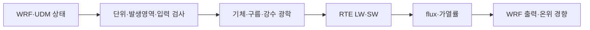

# UDM27–RRTMGP37 코드 길잡이

**대기 상태를 단위가 맞는 광학 입력으로 바꾸고, 복사 flux를 계산한 뒤 WRF 경향으로 돌려주는 코드다.** 먼저 아래 세 경계를 구분하면 된다.



## 1. 생산 코드는 이 순서로 읽는다

| 순서 | 파일·심볼 | 한 가지 책임 |
|---|---|---|
| 1 | `WRF/share/input_wrf.F` | 지원 설정·파일 계약 확인 |
| 2 | `WRF/phys/module_mp_udm.F` | number 변환·native 과정·반경·반환 |
| 3 | `WRF/dyn_em/module_first_rk_step_part1.F` | 같은 물리 호출의 dry mass·density 전달 |
| 4 | `WRF/phys/module_ra_rrtmg_lw.F`, `module_ra_rrtmg_sw.F` | WRF 배열과 컬럼 사이의 포장·반환 |
| 5 | `WRF/phys/module_ra_rrtmgp_input.F` | 입력 검사·grid/in-cloud path·seed |
| 6 | `WRF/phys/module_ra_rrtmgp.F` | RRTMGP optics·RTE 호출·workspace |
| 7 | `scatter_lw_column`, `scatter_sw_column` | 지표/상단 flux와 K/day→온위/s |

`precip`는 rain/snow, `frozen`은 실험 graupel/hail, `trace/audit/hash`는 관측·감사·식별이다. `WRF/external/rte_rrtmgp`가 실제 core다. 루트 `port/src`의 성분 bridge를 현재 WRF solver 진입점으로 착각하지 않는다.

## 2. 변수는 분모와 시간 위치까지 읽는다

| 변수 | 뜻 | 주의 |
|---|---|---|
| qv, qc, qr 등 | kg/kg **dry air** | specific humidity와 다름 |
| η number | 입자 수/kg dry | UDM의 체적 number와 다름 |
| `a=C1H*MUT+C2H` | native pressure coupling, Pa | 층질량 kg/m²가 아님 |
| `-DNW*a/g` | 실제 dry layer mass, kg/m² | 순간 압력차분 질량으로 대체하지 않음 |
| grid path / in-cloud path | g/m² | 양의 CF에서는 in-cloud=grid/CF |
| native radius | µm | LUT 유효직경·PSD metric과 별도로 확인 |
| `T` history | dry 온위 섭동 | 기온은 `(T+300)*Exner` |
| moist θ | `θd*(1+r*qv)` | 실제 수송 field의 섭동·pressure coupling 확인 |
| geometric W | m/s, interface | η 질량 flux `WW/rom`이 아님 |
| HR 반환 | K/day | wrapper에서 86400·Exner로 변환 |
| SWDDIR / SWDDNI | 수평 직달 / 법선 직달 | DNI 관측과 혼용하지 않음 |
| PRATEC / RAINCV | 이후에 쓸 강수율 / 완료 구간 강수량 | 마지막 유효량과 다음 지면 호출의 지연 보존 |

## 3. 최근 검증·보고 코드는 네 단계다


| 코드 | 역할 |
|---|---|
| [`analyze.py`](../../validation/rrtmgp37/sterling-transport-state/analyze.py) | 실제 REAL32 연산 재생과 선언한 진단 배분 |
| `replay_layer()` | 한 step·한 층의 면 발산·이전 경향·단위 연결 |
| `summarize_layers()` | 같은 기준의 시간별/5시간 합계 |
| [`report.py`](../../validation/rrtmgp37/sterling-transport-state/report.py) | 원래 schema의 JSON·CSV 저장 |
| [`write_readme.py`](../../validation/rrtmgp37/sterling-transport-state/write_readme.py) | 표 구성과 순수 문서 렌더링; `main()`만 I/O |
| [`verify_saved.py`](../../validation/rrtmgp37/sterling-transport-state/verify_saved.py) | 실행·소스·입력·수치·문서의 실제 연결 |
| [`test_saved.py`](../../validation/rrtmgp37/sterling-transport-state/test_saved.py) | actual operand 변조와 생성기 회귀 |

계산 함수는 물리 정책을 새로 선택하지 않는다. 표 함수는 과학 결과를 바꾸지 않는다. identity는 확인할 바이트를 지정하고, verifier는 그 바이트뿐 아니라 수치 재생과 숫자 표 내용을 검사한다.

## 4. 수정할 때 지킬 작은 규칙

1. 먼저 바꾸려는 경계와 단위를 한 문장으로 쓴다.
2. 한 변수에 표 행과 수치 dictionary처럼 다른 역할을 맡기지 않는다.
3. native REAL32 식의 괄호·순서를 ‘간단한 동치식’으로 바꾸지 않는다.
4. 물리 source·수송·정규화·산술 잔차를 구분한다. 잔차를 특정 물리항에 맞추지 않는다.
5. 기존 scientific archive와 결과는 원 실행의 근거로 유지한다. 새 source의 결과로 소급 재표기하지 않는다.
6. 변경 경계에 맞는 시험을 실행한다. 문서 정리만으로 모델을 반복할 필요는 없다.
7. 보고서 생성기를 실행한 출력도 확인한다. hash가 맞는 문서가 올바른 문서라는 보장은 없다.

## 5. 검증 명령과 의미

```sh
python -I -S validation/rrtmgp37/sterling-transport-state/verify_saved.py
python -I -S validation/rrtmgp37/sterling-transport-state/test_saved.py
python validation/rrtmgp37/acceptance/test_verify.py
python -I -S docs/porting/review_math.py
```

위 명령은 저장 자료·연산·보고서 산술의 재생이다. 새 WRF 예보·RTE·Mie 또는 과학적 정확도 PASS가 아니다. 실제 WRF 빌드·SCM·CMake 설치 경로는 `.github/workflows/validate-port.yml`, `validate-connected-host.yml`, `validate-cmake-package.yml`에서 확인한다.

전체 설명과 완료/미승인 범위는 [상세 기술보고서](TECHNICAL_REPORT_ko.md)를 읽는다.
