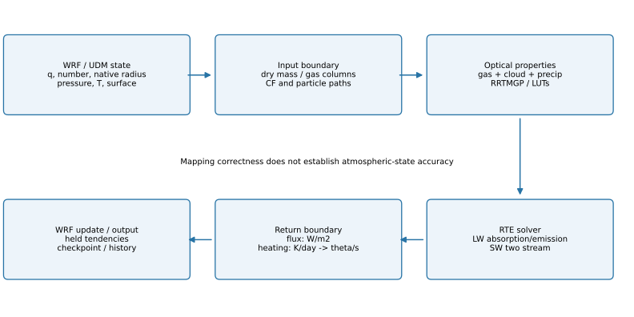
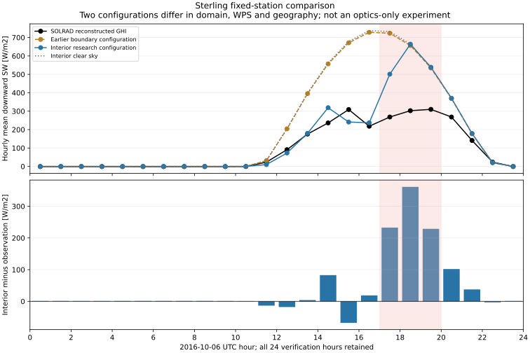

# 1. 결론과 읽는 순서

**고정된 직렬 연구 구성의 포팅과 공학 검증은 1차 완료다. 물리적 적용성과 최종 예보 성능까지 승인한 상태는 아니다.** 현재 가장 큰 적용 제한은 Sterling 사례의 오후 구름 지속시간과 지표 단파일사 오차다.

이 보고서는 PR #208 병합 main `b69c8041d52ade8eeb71580ecd8bc37a2f4d7350`을 과학 결과의 기준으로 삼는다. 이번 정비는 최근 검증·보고 코드의 가독성과 책임 분리를 개선했다. 생산 WRF·UDM·RTE 계산, 광학계수, 기본 정책과 저장된 과학 결과는 유지했다.

| 질문 | 현재 답 |
|---|---|
| WRF가 UDM 상태를 37번 복사 계산에 전달하고 결과를 적용하는가? | 선언한 구성에서 실제 실행·기록·독립 재생으로 확인 |
| 확인된 재시작·잔류 강수율·최종 음수 수증기 문제가 남았는가? | 해당 사례와 시험 범위에서 수정·검증 완료 |
| 최근 구름 소실·온습도·수직수송 진단이 끝났는가? | 각각의 연산 귀속과 좌표 연결 단계 완료 |
| 해석한 구름 소실이 실제 대기에서도 맞는가? | 승인할 수 없음. 저층운·온습도·일사 관측과 불일치가 남음 |
| Mie 수치 일치가 젖은 우박의 물성을 입증하는가? | 아니다. 같은 건조 구형 ice-Ih·PSD 정의의 조건부 수치 검증 |
| 일곱 과학적 종료 조건과 최종 4/37 예보 비교가 모두 끝났는가? | 아니다. 남은 독립 참조·입자 대표성·최종 비교 조건을 유지 |

먼저 2–3절에서 실행 범위와 코드 흐름을 읽고, 단위·부호·보존성은 4절, 실제 대기와의 관계는 6절, 재현성과 코드 정비는 7–8절에서 확인하면 된다. 빠른 코드 탐색은 [코드 길잡이](CODE_GUIDE_ko.md)를 사용한다.

# 2. 검토 기준과 지원 범위

## 2.1 이번에 완료로 다루는 구성

| 항목 | 고정 값 |
|---|---|
| 미세물리 / 장파 / 단파 | UDM27 / LW37 / SW37, `use_mp_re=1` |
| 영역 / 실행 | 단일 specified 영역, serial, one tile |
| 수농도 / population / scalar 수송 | `number_policy=1`, `population_policy=0`, `scalar_adv_opt=0` |
| 복사 열용량 / 액체 광학크기 | `capacity_policy=0`, `liquid_size_policy=0` |
| frozen 광학 | 명시적인 experimental frozen1 |
| 모델 / 복사 간격 | 60 s / 600 s |
| 최신 내부영역 사례 | 2016-10-06 00:00–2016-10-07 00:00 UTC |

Gamma8·capacity1의 warm-periodic·population2 연구 옵션은 위 구성과 다르다. 일반 MPI/OpenMP·중첩·다른 미세물리 조합도 이 완료 판정에 포함하지 않는다. 과거 특정 병렬 실험이 성공했다는 사실은 보존하지만, 그것을 현재 specified number1 조합의 일반 지원으로 합산하지 않는다. [지정경계 계약](../../WRF/test/rrtmgp/UDM_SPECIFIED_NUMBER.md), [연구 복사 옵션](../../WRF/doc/rrtmgp/RESEARCH_RADIATION_OPTIONS.md).

## 2.2 소스와 자료의 계보

| 구성 요소 | 기준과 확인 위치 |
|---|---|
| WRF | v4.8.0 기반 `06d4240ae989cc3e50af412bb472df3d9048783c`; [import 목록](../../config/imported-sources.json) |
| 실제 WRF 안의 RTE+RRTMGP | UFS가 고정한 `41c5fcd950fed09b8afe186dede266824eca7fd3`; [SOURCE](../../WRF/external/rte_rrtmgp/SOURCE.json) |
| 기체·구름 계수 | 데이터 커밋 `ea788bb39876948fa8d2c235665ccff19b4686b5`; [DATA와 파일 hash](../../WRF/external/rte_rrtmgp/DATA.json) |
| 공학·과학 결과 기준 | PR #208 main `b69c8041…`; 전체 tree `2e3a9cb88c5211405872b977373eb1c2ace6de8c` |
| WRF subtree | `8adaf66b65a7283a77621b4f66bf0a2c218fd336`; 이번 정비에서도 동일 |
| 실제 기준선 연결 | 각 실행의 identity에 소스·실행파일·입력·계수·namelist·산출물 식별값 보존 |

고정 upstream의 API와 계수를 하나의 묶음으로 읽는다. 현재 upstream 문서는 개념 설명의 참조이며, 이 저장소가 최신 API나 모든 최신 옵션을 구현했다는 뜻은 아니다. RTE는 광학량·방출원·경계조건으로 flux를 계산하고, RRTMGP는 온도·압력·기체 농도에서 기체 광학량과 source를 준비한다. [공식 설명](https://earth-system-radiation.github.io/rte-rrtmgp/explanations/), [개발 논문](https://doi.org/10.1029/2019MS001621).

# 3. 구현 구조: 상태 → 광학량 → flux → 경향



## 3.1 생산 호출 경로

1. `solve_em`의 물리 호출 경로에서 같은 시점의 native 건조층 질량과 건조밀도를 구성한다.
2. `module_radiation_driver`와 기존 LW/SW wrapper가 압력·기온·기체·지면·구름 입력을 준비한다.
3. `module_ra_rrtmgp_input`이 수상별 grid-mean 및 in-cloud 경로와 입력 계약을 확인한다.
4. `module_ra_rrtmgp`가 기체·구름·강수 광학을 합성하고 RTE를 호출한다.
5. wrapper가 전천·청천 flux, 직달·산란, 가열률을 WRF 배열과 온위 경향으로 돌려준다.
6. 다음 복사 호출 전에는 WRF가 보존한 복사 경향을 적용한다. 이것은 새 복사 계산이 아니다.

| 파일 | 책임 | 이 파일의 성공만으로 입증되지 않는 것 |
|---|---|---|
| [`module_first_rk_step_part1.F`](../../WRF/dyn_em/module_first_rk_step_part1.F) | 실제 물리층의 질량·밀도와 radiation 호출 | 모든 열원·물수지의 전역 폐합 |
| [`module_ra_rrtmg_lw.F`](../../WRF/phys/module_ra_rrtmg_lw.F), [`module_ra_rrtmg_sw.F`](../../WRF/phys/module_ra_rrtmg_sw.F) | WRF 입력 준비·컬럼/batch·결과 scatter | 입력 대기 상태의 관측 정확도 |
| [`module_ra_rrtmgp_input.F`](../../WRF/phys/module_ra_rrtmgp_input.F) | 단위·모양·범위·수상 경로·seed 계약 | 실제 PSD·입자 발생분율의 타당성 |
| [`module_ra_rrtmgp.F`](../../WRF/phys/module_ra_rrtmgp.F) | 초기화·기체 설정·광학 합성·RTE 호출 | 공급된 물성 자체의 정확도 |
| [`module_ra_rrtmgp_precip.F`](../../WRF/phys/module_ra_rrtmgp_precip.F), [`module_ra_rrtmgp_frozen.F`](../../WRF/phys/module_ra_rrtmgp_frozen.F) | 강수·실험 frozen 광학 | 일반적인 젖은 우박·융해 입자 광학 |
| `module_ra_rrtmgp_trace/audit/hash.F` | capture·감사·식별 | 관측과의 성능 승인 |

루트 `port/src`는 초기 수치 계약·host bridge의 성분 시험 코드다. 실제 WRF의 37번 생산 진입점은 `WRF/phys`에 있다. 두 경로를 같은 solver나 같은 실행 캠페인으로 혼동하지 않는다.

## 3.2 배열·정밀도·수직 순서

WRF native 배열은 주로 `(i,k,j)`이고, 컬럼 API는 `(column,layer)`다. 물리 컬럼과 실제 층만 포장하며 halo·중복 staggered 점은 영역 수지에 합산하지 않는다. 컬럼은 **지면부터 위로** 배열하고 RTE 호출의 `top_at_1=.false.`와 맞춘다. 층 중심과 interface 배열은 각각 `nlay`, `nlay+1`이다.

WRF의 REAL 입력·출력과 내부 `REAL(wp)` 계산 경계를 구분한다. REAL32로 저장된 값의 재생과 REAL64에서 수행한 진단 합계가 같은 산술이라고 가정하지 않는다. 최종 형변환의 비유한값·범위 검사도 결과 계약의 일부다. [유한 출력 계약](../../WRF/doc/rrtmgp/OUTPUT_FINITE_CONTRACT.md).

WRF는 hybrid terrain-following mass 좌표와 C-grid를 사용한다. native `W`는 interface의 기하학적 속도이고, 수송의 `WW/rom`은 질량·map factor가 결합된 η좌표 flux다. 단위가 비슷하거나 부호가 같다는 이유로 pressure omega·관측 수직속도와 동일시하지 않는다. [WRF 공식 좌표 설명](https://www2.mmm.ucar.edu/wrf/site/documentation/users_guide/dynamics.html).

# 4. 수학 검토

이 절은 차원·정규화·부호·유한변화 항등식과 코드 경계를 검토한다. 식이 맞는다는 사실과 실제 대기에서 그 가정이 적절하다는 판단은 별개다.

## 4.1 건조층 질량과 수분 경로

native pressure coupling을

$$a_k=C_{1H,k}(MU+MUB)+C_{2H,k}\quad[\mathrm{Pa}]$$

로 쓰면 실제 건조층 질량은

$$m_{d,k}=-\Delta\eta_k\,a_k/g\quad[\mathrm{kg_{dry}\,m^{-2}}]$$

다. `DNW=Δη<0`이므로 양의 $a_k$에서 $m_d>0$이다. 물리 호출의 `MUT`와 현재 dry density를 사용하며, 단순한 순간 비정역학 압력 차분 `Δp/g`를 건조질량으로 대체하지 않는다.

수상 $x$의 혼합비 $q_x$가 kg/kg dry이면

$$WP_{x,grid}=1000\,m_d q_x\quad[\mathrm{g\,m^{-2}}],$$
$$WP_{x,in}=WP_{x,grid}/f_c\quad(f_c>0).$$

따라서 같은 발생영역을 사용하는 한 $f_c WP_{in}=WP_{grid}$다. $f_c=0$인 경우에는 이 나눗셈을 하지 않는다. 직접 builder/adapter는 양의 응결물과 CF0의 모순을 거부하지만, WRF wrapper는 구름 mask를 사용하는 CF0 응결물 경로를 선언한 예외로 광학에서 제외하고 그 양을 기록한다. 이는 항상 무시해도 될 만큼 작은 양이라는 보장이 아니다. **제외 질량을 보존된 광학 기여로 세지 않는다.** 입력 음수에 대한 좁은 허용·거부 정책도 전체 상태를 일괄 clipping하는 정책과 다르다.

실제 소스는 `module_first_rk_step_part1`의 질량 구성과 `rrtmgp_build_udm_inputs`다. native 질량은 기체와 수상 경로에 사용되지만, 기본 가열률의 열용량 정의까지 자동으로 같아지는 것은 아니다. [건조질량 계약](../../WRF/doc/rrtmgp/NATIVE_DRY_MASS.md).

frozen1의 graupel/hail은 별도 occurrence=1 정의를 사용하므로 일반 구름 CF로 다시 나누거나 CF0만으로 지우지 않는다. 위 in-cloud 식은 해당 CF 발생영역을 사용하는 경로의 식이다.

**독립 산술 예:** $\Delta\eta=-0.02$, $a=90000$ Pa, $g=9.81$이면 $m_d=183.486239$ kg/m²다. $q_c=2\times10^{-4}$, CF=0.4이면 grid path=36.697248, in-cloud path=91.743119 g/m²이며 CF를 곱하면 원 경로가 복원된다. 이 예는 제조 상태의 차원 검사이며 새 WRF 실행이 아니다.

## 4.2 수농도: 체적당 수와 건조질량당 수

`number_policy=1`의 host 저장값은

$$\eta_N=N/\rho_d\quad[\mathrm{kg_{dry}^{-1}}].$$

UDM 진입 시 같은 호출의 건조밀도로 $N=\rho_d\eta_N$을 복원한다. native 미세물리와 반경 진단이 이 체적 수농도를 소비한 뒤, 같은 밀도로 나누어 host에 반환한다. 밀도가 바뀌면 같은 η에서도 체적 수농도 N은 바뀐다. 이것을 입자 생성으로 오인하지 않는다.

지정경계의 파일 값은 η 자체가 아니라 $S=a\eta_N$ 형태의 결합량이며, 시간 경향은 저장 endpoint의 $(S_{n+1}-S_n)/\Delta t$다. 밀도와 pressure coupling 변화를 생략한 체적 수농도 선형 보간으로 대체할 수 없다. CCN의 유입 배경과 cloud/rain number의 파일 경계는 계약이 다르다.

코드상 변환이 성립해도 population의 grid-mean/in-cloud 의미가 자동으로 결정되지는 않는다. 고정 실자료의 population0와 warm 연구의 population1/2를 구분한다. 또한 `scalar_adv_opt=0`은 qv의 실제 PD 갱신 경로와 동일한 옵션 이름이 아니다. [UDM 진입·반경·반환](../../WRF/phys/module_mp_udm.F), [number 경계 계약](../../WRF/test/rrtmgp/UDM_SPECIFIED_NUMBER.md).

## 4.3 기체 column과 습도 표현

건조공기 molecular column은

$$N_d=m_d\frac{N_A}{M_d}\frac1{10^4}\quad[\mathrm{molecules\,cm^{-2}}]$$

다. $M_d$는 kg/mol, $N_A$는 mol⁻¹이다. 예를 들어 $m_d=1$ kg/m², $M_d=0.028964$ kg/mol이면 약 $2.07918\times10^{21}$ molecules/cm²다. 물리층은 이 native column을 사용하고, 모델 상단 확장층은 기존 pressure/VMR 규약을 유지한다.

건조공기 질량혼합비 $r_v$와 건조공기 기준 VMR의 관계는

$$x_v=r_v\,M_d/M_v.$$

RH에서 혼합비를 진단할 때는 $e=(RH/100)e_s(T)$, $r_v=\epsilon e/(p-e)$를 사용한다. `RH × 포화 혼합비`는 일반적으로 같은 식이 아니다. 실제 REAL의 방법·범위 처리와 일치하는지 별도로 확인한 [입력 계보 진단](../../validation/rrtmgp37/sterling-low-level-evolution/README.md)을 유지한다.

LW 설정에는 기본 기체 6종, CFC11/CFC12/CFC22/CCl4와 배경 N2가 있으며 `names_lw`의 concentration 이름은 11개다. SW는 기본 6종이다. 이를 단순히 같은 기체 목록이라고 쓰지 않는다. 온도·압력은 여전히 광학계수 보간과 방출원 계산에 필요하다. [native gas column](../../WRF/doc/rrtmgp/NATIVE_GAS_COLUMNS.md), `set_gases_lw/sw`, `gas_dry_column`.

## 4.4 광학크기와 PSD 정규화

액체·얼음 LUT의 좌표는 같은 이름의 ‘반경’이라고 모두 같지 않다. 현재 adapter는 얼음 LUT의 유효직경으로 변환하며, legacy Fu 크기 flag의 경우 별도의 1.0315 관계를 처리한다. 실제 UDM 반경과 원 LUT를 생성한 입자군의 metric 동등성은 추가 물리 근거가 필요한 조건이다.

선택적인 Gamma8 액체 연구 경로에서는 반경 분포를 shape $\alpha=8$로 정의할 때

$$M_2=M_0\frac{8\cdot9}{\lambda^2},\qquad
M_3=M_0\frac{8\cdot9\cdot10}{\lambda^3},\qquad
r_{eff}=M_3/M_2=10/\lambda.$$

이것은 기본 실자료의 liquid-size0 경로를 바꾼 것이 아니다. `rrtmgp_research_column`의 식과 연구 옵션의 warm·population2 제한을 함께 읽어야 한다. 숫자 모멘트가 맞는다는 이유만으로 실제 구름의 PSD나 원 LUT population을 승인하지 않는다.

frozen1의 직경 지수 PSD는 $N(D)=N_0e^{-\lambda D}$다. 구형 입자 $m(D)=\pi\rho_b D^3/6$에 대해

$$\int_0^\infty m(D)N(D)dD=\pi\rho_bN_0/\lambda^4,$$
$$\kappa_{abs}=\frac{\int_0^\infty (\pi D^2/4)Q_{abs}(D)N(D)dD}{\pi\rho_bN_0/\lambda^4},\qquad
\tau_b=WP_{g/m^2}\,10^{-3}\kappa_{abs,b}.$$

직경 PSD와 반경 PSD를 섞으면 면적·질량의 계수가 달라진다. 무한 분포의 해석적 질량분모와 제한된 수치 적분구간도 구분한다. 실제 입자 경로가 없는 경우까지 나누거나 sentinel을 물리적 크기로 승인하지 않는다.

## 4.5 Frozen 밀도·물성의 남은 계약

현재 UDM에는 건조밀도 $\rho_d$가 입력된다. radiation 준비 배열은 $\rho_d(1+q_v)$이며 frozen λ 진단은 이 radiation 밀도를 사용한다. 상한과 cutoff가 비활성일 때

$$\lambda=\left(\frac{\pi\rho_bN_0}{\rho q}\right)^{1/4},\qquad
\lambda_{rad}/\lambda_{dry}=(1+q_v)^{-1/4}.$$

따라서 두 PSD 정의가 완전히 같다고 주장하지 않는다. `rrtmgp_udm_frozen_lambdas`에는 λ 상한 20,000 m⁻¹과 작은 혼합비 cutoff가 있으므로, 상한 출력만으로 제한 전 PSD가 적격했다고 판정할 수 없다.

현재 진단 상수는 graupel의 bulk density=500 kg/m³, N₀=4×10⁶ m⁻⁴, hail의 density=912 kg/m³, N₀=4×10⁴ m⁻⁴다. 이는 고정 진단 PSD의 정의이며 이번에 관측에 맞춰 선택·조정한 값이 아니다.

정적 ice-Ih 굴절률을 실제 층 온도의 Planck 함수로 가중하는 것과 굴절률 자체의 온도 의존성은 다른 문제다. Warren–Brandt 자료는 명목 266 K의 ice-Ih 편집 자료이며 젖은 우박의 액체 함량·형상·융해 구조를 결정하지 않는다. [현재 frozen 정의](../../WRF/doc/rrtmgp/UDM_FROZEN_EXPERIMENT.md), [원 물성 자료](https://www.atmos.washington.edu/ice_optical_constants/), [원 논문](https://doi.org/10.1029/2007JD009744).

## 4.6 광학 합성과 복사 수송

복사전달 방정식을 광선 경로 $s$에 따라 쓰면, LTE 설명 범위에서

$$\frac{dI_\nu}{ds}=-(\kappa_{a,\nu}+\kappa_{s,\nu})I_\nu
+\kappa_{a,\nu}B_\nu(T)
+\frac{\kappa_{s,\nu}}{4\pi}\int P_\nu(\Omega',\Omega)I_\nu(\Omega')d\Omega'.$$

여기서 κ는 길이당 계수이고, 이 적분으로 생기는 방향별 복사장을 flux로 적분한다. RRTMGP의 correlated-k 접근을 단일 층의 설명식으로 쓰면 밴드 투과율은

$$\overline{\mathcal T}_b(u)\simeq\sum_{g\in b}w_g\exp(-k_g u).$$

$k_g u$는 무차원이며 $w_g$는 분광 적분 가중치다. 실제 core는 온도·압력·혼합 기체에 대한 계수·보간·source를 포함하므로 위 설명식을 직접 solver로 대체하지 않는다. LW128·SW112는 선택한 자료의 g점 개수이지, 독립적인 단색 파장 수나 line-by-line 정확도 보장이 아니다. 현재 컬럼 계산은 수평으로 균질한 평면평행 가정이며 3차원 구름 옆면의 조명·차폐까지 풀지 않는다.

개념적으로 광학두께는 같은 분광 격자의 기체·구름·강수 기여를 더한다. 산란계의 단일산란알베도와 비대칭인자는 광학두께와 산란량으로 가중해야 하며, 단순 산술평균이 아니다.

$$\tau=\sum_i\tau_i,\quad
\omega_0=\frac{\sum_i\omega_{0,i}\tau_i}{\tau},\quad
g=\frac{\sum_i g_i\omega_{0,i}\tau_i}{\sum_i\omega_{0,i}\tau_i}.$$

분모 0인 청천·무산란 상태는 별도 경로다. 실제 구현은 RTE optical-properties API와 precipitation/frozen 경로를 이용한다. delta scaling의 적용 단계도 광학량 정의와 함께 보존한다. 같은 입자를 중복 합성하거나 scaled/unscaled 직달량을 혼동하지 않는다.

평균 물경로 보존과 flux 보존은 같은 명제가 아니다. 투과율은 비선형이므로 일반적으로 $E[\exp(-\tau)]\ne\exp(-E[\tau])$다. 따라서 같은 grid path에서도 발생분율·중첩·입자 분포가 달라지면 복사 결과가 달라질 수 있다.

구름 overlap·McICA mask는 CF와 물경로의 발생영역을 연결한다. seed는 domain·전역 격자·날짜·LW/SW 구분으로 재현되며 같은 날짜의 시간 변화까지 독립 표본으로 재추출한다고 가정하지 않는다. frozen1의 occurrence=1과 구름 mask의 통계적 의미도 구분한다. [seed 계약](../../WRF/doc/rrtmgp/DOMAIN_CALENDAR_SEEDS.md), [광학 비교](../../WRF/doc/rrtmgp/OPTICS_COMPARISON.md).

현재 LW는 흡수·방출, SW는 2-stream 산란 경로다. 장파 산란·일반 aerosol 경로·3차원 구름 수평 복사를 구현·승인한 것으로 확대하지 않는다. RTE 수송 일관성은 광학 입력의 실제 대기 대표성을 보장하지 않는다.

## 4.7 Flux 부호와 가열률

위로 향하는 net flux를 $U=F^\uparrow-F^\downarrow$라 두면, bottom-first 층의 에너지 수렴은

$$Q_k=U_{k,bottom}-U_{k,top}=D_{k,top}-D_{k,bottom},\quad D=-U.$$

$Q_k>0$은 가열이다. 기본 pressure-mass 경로는

$$C_{p,k}=c_{pd}(p_{bottom}-p_{top})/g,\qquad \dot T_k=Q_k/C_{p,k}.$$

RTE helper가 K/s를 계산하고 adapter는 기존 wrapper 계약에 맞춰 K/day로 반환한다. wrapper는 86,400으로 나눈 뒤 Exner $\Pi$로 나누어 $\dot\theta$로 전달한다. `scatter_lw_column`의 `hr/86400/pi3d`와 `mo_heating_rates`를 연결해 부호와 단위를 확인했다.

선택적인 capacity1은 native 층에서

$$C_k=m_{d,k}c_{pd}(1+(R_v/R_d)q_v)$$

를 사용한다. 이는 선언한 constant-κ 연구 정의이고 응결물 열용량을 포함한 보편적 혼합물 열용량과 같지 않다. 기본 실자료는 capacity0이므로 이 식을 해당 하루의 적용 정의로 바꾸어 쓰지 않는다.

같은 영역·층·열용량에서 $\sum C_k\dot T_k=D_{top}-D_{bottom}$가 성립하는지 볼 수 있다. 그러나 모델 native top과 확장층 TOA, 전 영역과 실제 경향 적용 내부 영역, pressure mass와 dry mass를 섞으면 같은 수지가 아니다. 이 차이를 보정계수로 없애지 않는다.

지면에서는 raw 하향 LW와 흡수된 LW를 구분한다. 현재 `GLW=dflx(1,1)`이며, 지면 소비 경로에서 방사율을 적용하는 위치를 확인해야 한다. SW의 `SWDDIR`은 수평 직달량이고 `SWDDNI`는 법선량이다. 관측 DNI를 수평 직달량과 직접 비교하지 않는다.

## 4.8 RK source·moist 온위·pressure coupling

수증기 source 사전갱신의 핵심은

$$q^*=\frac{a_{old}q_{old}+\Delta t T_q}{a_{new}}.$$

유한한 양의 $a_{new}$에서 입력이 비음수여도 분자가 음수면 source 단계가 음수를 만든다. $T_q\ge-a_{old}q_{old}/\Delta t$는 이 단계의 비음수 조건이다. 실제 경계 제한은 입력·선행 source가 적격일 때 과도한 외부 제거만 제한한다. 이 부등식을 모든 물리에 적용하는 clipping 규칙으로 사용하지 않는다.

PD 반올림 수정은 갱신 뒤 q를0으로 만드는 대신 donor의 공유면 outgoing antidiffusive flux를 줄인다. 코드의 여유는

$$\gamma_{64}=\frac{64\epsilon}{1-64\epsilon},\qquad
B_{usable}=\max\{0,B_{low}-\gamma_{64}(|B_{old}|+N_{low}+F_{out})\}$$

형태이며 양의 scale은 `NEAREST`로 한 단계 낮춘다. 같은 공유면이 이웃 셀에 반대 부호로 사용되는 발산 구조를 유지한다. 다만 이64연산 여유를 모든 compiler·최적화·CFL·부적격 low-order 상태에 대한 증명된 오차 상계로 확대하지 않는다. 경계 source 제한도 실제 수용한 외부 교환을 장부에 계상하며, 요청량과 수용량이 언제나 같다는 물리 정책은 아니다.

$B=a t'_m$, $\theta_m=t'_m+300$, $\theta_d=\theta_m/(1+r q_v)$라 두면

$$\Delta\theta_m=\frac{\Delta B-t'_{m,0}\Delta a}{a_1},$$
$$\Delta\theta_d=\frac{\Delta\theta_m}{1+r q_1}
-\frac{r\theta_{d,0}}{1+r q_1}\Delta q.$$

이는 endpoint 분모를 공유한 유한변화 항등식이다. 기온은 다시 $T=\Pi\theta_d$이므로

$$\Delta T=\Pi_1\Delta\theta_d+\theta_{d,0}\Delta\Pi.$$

시간별 기온 차이를 그대로 PBL·복사 가열량이라고 부르지 않는다. 실제 수송은 결합 moist 섭동 온위를 적분하며, acoustic 항·수증기 변환·held 미세물리 가열의 최종 제거를 함께 처리해야 한다. RK predictor 세 개를 각각 독립된 60 s로 더하면 안 된다. [실제 경향 재생](../../validation/rrtmgp37/sterling-thermodynamic-tendencies/README.md).

## 4.9 보존형 face 항과 공기덩이 해석

실제 η 수직 항은 $-\mathrm{rdnw}(F_t-F_b)$다. 중심값 $q_0$를 택하면

$$F_t-F_b=[(F_t-q_0M_t)-(F_b-q_0M_b)]+q_0(M_t-M_b).$$

두 부분은 기준값에 의존한다. 두 번째를 독립 수분 source라고 부르거나, 이 항 하나를 $-w\partial q/\partial z$ 또는 공기덩이의 습윤화로 읽지 않는다. PD의 최종 면 flux에는 low-order와 제한된 antidiffusive 부분을 모두 포함한다. native 반올림 차이는 별도다.

15–16 UTC 8층의 실제 결과는 상대 face −0.1680735072, 중심×질량flux차 +0.3140906219, 산술 차이 약 −1.78×10⁻⁹ g/kg이며 합은 +0.1460171129 g/kg다. 위층이 더 건조하고 geometric W가 음수인 60개 step과 모순되지 않는다. theta의 순간 flux와 qv의 acoustic 시간평균 flux도 같은 시점의 자료가 아니다. [수직 face·좌표 근거](../../validation/rrtmgp37/sterling-transport-state/README.md).

## 4.10 경계·강수·전체 수지

5점 완화는 $E=B-S$에 대해

$$\delta T_{LBC}=F E_0-G(E_W+E_E+E_N+E_S-4E_0).$$

모든 목표가 0이어도 이웃의 상태에 따라 공간항은 양수가 될 수 있다. 실제 원 지점의 16–17시 응결물은 완화 전부터 0이었고, 직접 제거로 설명할 수 없다는 제한 판정이 완료됐다. 가장 안쪽 0계수의 존재와 실제 core 호출 범위도 구분했다. [실제 5점 재생·입력 출처](../../validation/rrtmgp37/sterling-boundary-forcing-decision/README.md).

KF Eta의 구간 강수 $V_n$은 현재 누계에 들어가고 다음 step 지면 호출에 전달된다. 따라서 비교기간에서

$$(R_N-R_0)-(L_N-L_0)=V_N-V_0.$$

끝에 남은 미전달량 차이를 물손실로 세지 않는다. 실제 패치는 마지막 유효 누적 후 PRATEC를 종료하고 RAINCV는 다음 지면 소비까지 유지한다. [강수율 수명 수정](../../validation/rrtmgp37/kfeta-precipitation-lifetime/README.md).

연산 장부가 상태 변화를 재구성하는 것과 독립적인 face flux로 전체 물수지가 닫히는 것은 다른 검사다. 실제 최종 RK 이류를 적분한 장부를 독립 측면 flux로 재명명하지 않는다. 전체 대기 에너지 폐합도 현재 승인하지 않는다.

# 5. 수정·검증이 끝난 공학적 문제

| 항목 | 원인과 조치 | 완료 근거의 범위 |
|---|---|---|
| 05:59 재시작 | 최종 지정 MU 갱신 뒤 halo가 이전 값을 남기던 순서 수정 | 원래 23/675 불일치가 675/675 동일로 전환 |
| 수정 cold의 재시작 | 수정 코드로 만든 checkpoint를 같은 코드로 재개 | 06·07시 225배열×2=450쌍 동일 |
| KF Eta 잔류 강수율 | NCA 종료 뒤 유지되던 PRATEC를 마지막 누적 후 종료 | 마지막 유효 강수·다음 지면 전달·정상 재활성화 확인 |
| PD 최종 음수 수증기 | 공유면 제한의 REAL32 여유 부족 | outgoing 공유면 flux에 반올림 여유, 사후 QV floor 없음 |
| 경계 source 과제거 | 선행 source가 적격인데 외부 완화가 가용 수증기를 초과해 제거 | 같은 old coupling·전체 source dt에서 해당 외부 교환만 제한 |
| SW 관측 공백 | 야간·미호출·부분 관측을 혼동하던 진단 범위 | 실제 144회 호출, 1,440 step, 야간 반환 0과 held source 분리 |
| 보고서 첫 표 | `state` 목록을 합계 dictionary로 덮어씀 | PR208 변수 분리·실제 생성기·JSON 일치·실패형 회귀 검사 |

수증기 수정 후 원래 지정경계 하루 실행의 시간별 음수 QV 표본은 193→0, 비활성 대류 양의 강수는 0.410907→0 kg/m²였다. 비교 장부 잔차는 +0.436572→+0.024441 kg/m²로 줄었다. 이는 실제 재적분 결과이며, 과거 누계에서 한 항을 빼서 만든 수정 예보가 아니다. 약94.40% 감소는 **장부 잔차의 감소율**이며 관측 예보 정확도의 향상률이 아니다.

| 수정 후 하루의 남은 장부 항 | kg/m² |
|---|---:|
| 상태·지표·경계 비교 잔차 | +0.0244411445 |
| 외곽 RAINC 별도 기여 | +0.0219614277 |
| 활성 대류 paired 잔차 | +0.0776833328 |
| PBL−같은 적용 영역의 QFX | −0.0786086437 |
| 양의 강수 없는 대류 경향 | +0.0046617401 |
| 미세물리 변화+해당 강수 | +0.0007009840 |

큰 과정별 항이 상쇄되므로 순잔차만으로 각 과정의 보존성을 승인하지 않는다. 위 수지는 원래 수정 지정경계 사례의 결과이며, 새 내부영역 하루의 독립 face 수지로 바꾸어 부르지 않는다. [수증기 원인·수정·실제 재평가](../../validation/rrtmgp37/vapor-first-operation/README.md).

최종 적용 경계에서 음수가 없다는 성공과 RK1/2 predictor의 일시적 undershoot도 구분한다. 수정 하루에는 predictor 표본 165,103개가 별도로 기록됐다. 이를 지우기 위한 새 clipping이나 최상위 완료 조건을 추가하지 않는다. 다른 호출 조합을 지원할 때 중간 상태의 실제 소비 위치를 검토하면 된다.

# 6. 기상학 검토: 코드의 설명과 대기의 적합성

## 6.1 사례·관측·대표성

대상은 2016-10-06 UTC 하루, NOAA SOLRAD Sterling 지점이다. 내부영역 최근접 격자는 1-based `(37,119)`, 27 km 격자이며 관측소와 약9.006 km 떨어져 있다. 질량격자는 `[143,90]`, 북쪽 물리 경계까지 24셀이다. 직접 완화띠 밖이라는 사실이 간접 경계 영향의 부재를 뜻하지 않는다.

이전 경계 인접 구성의 최근접 위경도는 같았지만 북쪽 경계에서2셀이었다. 새 구성은 영역 확장뿐 아니라 WPS4.3→4.6 및 저해상도 지리자료도 함께 달라졌다. 따라서 두 점수의 차이는 **구성 전체의 차이**다. 순수 경계 거리 효과나 복사 광학 코드만의 개선율이 아니다.

입력 계보에서 응결물은 유효 WPS intermediate·met_em에 미제공되어 REAL 기본0이 된 것으로 확인됐다. 후속 number 생산기는 원 배열을 보존했다. 이0은 외부 대기가 물리적으로 청천이었다는 관측 증거가 아니다. 저해상도 지리자료·지형·육해 마스크 차이와 27 km 점/격자 대표성도 예보 적용의 제한이다. [입력 준비·출처](../../validation/rrtmgp37/sterling-boundary-forcing-decision/README.md), [전처리 차이](../../validation/rrtmgp37/sterling-interior-day-evaluation/README.md).

## 6.2 채점의 시간·단위 계약

모델 시간평균은

$$\bar F_{M,h}=[ACSWDNB(t_{h+1})-ACSWDNB(t_h)]/3600.$$

관측은 각 시간의 $(t_h,t_{h+1}]$에 해당하는 60개 분별 period-end 자료에서

$$\bar F_{O,h}=\frac1{60}\sum_{m=1}^{60}[DNI_m\max(\cos\theta_{z,m},0)+DHI_m]$$

로 재구성한다. 순간 `SWDOWN`, 평균 DNI×평균 cosine, 보조 PSP에 의한 결측 대체로 점수를 바꾸지 않는다. 야간의 작은 음의 관측도 보존한다. QC 통과를 불확실도0으로 해석하지 않는다.



| 지표 | 원 경계 인접 구성 | 내부영역 구성 |
|---|---:|---:|
| 24h bias, W/m² | +113.0654 | +40.7164 |
| 24h MAE, W/m² | 113.3353 | 49.2587 |
| 24h RMSE, W/m² | 198.9082 | 104.3044 |
| 주간12h bias, W/m² | +225.1299 | +80.4319 |
| 주간12h RMSE, W/m² | 281.2969 | 147.5053 |
| 하루 모델 일사, MJ/m² | 18.246844 | 11.995889 |
| 같은 관측 일사, MJ/m² | 8.477990 | 8.477990 |

내부 구성의 RMSE는 두 구성 사이에서 약47.56% 감소했지만 하루 일사는 관측보다 약41.50% 높다. 이 station-day의 기술통계이며 일반 예보 skill 향상률이나 RRTMGP 단독 오차율이 아니다. 수용 목적과 허용량은 아직 확정되지 않았다. [기존 점수](../../validation/rrtmgp37/real-output-independent-comparison/hourly-comparison.csv), [내부 점수](../../validation/rrtmgp37/sterling-interior-day-evaluation/hourly-comparison.csv).

## 6.3 남은 오차는 오후 구름 감쇠의 소실과 연결된다

17–20 UTC가 내부 구성 하루 제곱오차 합의 약90.75%를 차지한다. 이는 사후 원인 조사 구간 선정이며, 불리한 시간대를 점수에서 빼는 규칙이 아니다.

| UTC | 모델 전천 | 모델 청천 | 전천−청천 | 관측 전천 |
|---|---:|---:|---:|---:|
| 16–17 | 237.0333 | 737.2122 | −500.1789 | 218.2881 |
| 17–18 | 500.9765 | 732.4667 | −231.4902 | 268.2537 |
| 18–19 | 663.8347 | 663.8361 | −0.0014 | 302.6331 |
| 19–20 | 538.5776 | 538.5778 | −0.0001 | 309.8233 |

단위는 W/m²이며 누계 기반 같은 시간평균이다. 18–19시 모델의 수평 직달/산란은 약610.17/53.67 W/m², 관측은 약12.17/290.47 W/m²였다. 모델의 큰 오차는 청천 기준선 상승보다 구름 감쇠 소실과 연결된다. 하지만 관측 전천값을 청천 참조로 사용하거나 이 차이만으로 광학계수 결함을 확정할 수 없다.

## 6.4 구름 소실은 국지 증발 하나로 설명되지 않는다

17시 native6층에 있던 구름물 약42.4974 g/m²가18시에는 없다. 실제 연산 귀속에서 6층 PBL 기여는 −32.9693 g/m²지만 기주 전체 PBL 구름물 변화는 거의0이었다. 즉 재분배가 중요했다. 기주 미세물리 구름물 감소는 약31.7892 g/m²이고 수증기는 약31.8219 g/m² 늘어 후속 증발과 일관된다. 6층만 한 시간 적분하면 미세물리는 오히려 구름물을 증가시킨다.

마지막17:35–17:36 구간의 미세물리에서 잔여 구름물 약0.696734 g/m²가 사라지고 수증기가 약0.696775 g/m² 증가하며 냉각됐다. 이는 해당 단계의 증발과 부호가 맞지만 모든 내부 반응률·잠열 에너지 폐합을 직접 측정한 것은 아니다. 고정 Eulerian 층은 폐쇄된 공기덩이가 아니므로 구름물 감소량을 전체 물손실로 해석하지 않는다. [구름 소실 귀속](../../validation/rrtmgp37/sterling-cloud-loss-operation/README.md).

## 6.5 독립 대기관측은 상태 불일치를 뒷받침한다

IAD는 모델 구름 소멸 이후17:52·18:52 UTC에 `BKN017`을 보고했다. 운저는 약518.16 m AGL이다. 보고 사이를 메워 연속 지속시간을 만들거나 ASOS의 BKN을 WRF 격자 평균 CF에 바로 대응시키지 않는다.

명목18UTC sounding의 실제 발사는17:34였다. 상승 경과시간과 풍선 이동을 고려한 압력 보간에서, 모델6→7층 기온 차는 약+1.5023 K인 반면 관측은 약−0.9494 K였다. 같은 구간의 건조 온위는 둘 다 위로 증가하며 관측 약+0.828 K, 모델 약+3.318 K다. 따라서 ‘관측은 불안정, 모델만 안정’이라고 쓰지 않는다. 습윤 안정도·entrainment는 추가 변수로 판단해야 한다.

관측 오전→오후900 hPa는 약−1.788 K 냉각, +2.301 g/kg 습윤화인 반면 모델12→18시는 +2.432 K 가열, −0.226 g/kg였다. 가까운11시 모델을 써도 불일치는 남는다. 반면 구동 `met_em`에는 오후 습윤화가 있으므로 ‘구동자료가 내내 건조했다’는 단일 설명도 충분하지 않다. 시간·위치·분석/예보 의미가 달라 이를 누락 source나 과정별 수지로 사용하지 않는다. [독립 대기 대조](../../validation/rrtmgp37/sterling-independent-atmosphere/README.md), [시간·입력 계보](../../validation/rrtmgp37/sterling-low-level-evolution/README.md).

## 6.6 온난·건조화의 실제 연산

12–17 UTC 건조 온위 기여는 다음과 같다. 생략한 확산·정규화·산술 항이 있으므로 표시 열만을 순변화와 같다고 요구하지 않는다.

| native 층 | Δθd, K | H 수송 | V 수송 | 복사 | PBL | 미세물리 |
|---|---:|---:|---:|---:|---:|---:|
| 6 | −0.7915 | +10.3939 | −10.1494 | −1.9733 | −1.6007 | +2.5210 |
| 7 | +1.5456 | −0.3969 | +2.3823 | +0.2445 | +0.0219 | −0.6415 |
| 8 | +3.0173 | +1.1028 | +2.0171 | −0.1286 | +0.0433 | 약0 |

8층 온난화는 수송 기여가 크다. 그러나 6→8층 온위 대비의 강화에는 아래층 PBL·복사 냉각도 기여하므로 ‘8층 직접 PBL 가열이 작다’와 ‘PBL의 역할 전체가 작다’를 구분한다. 특정 PBL 계수 오류는 이 결과만으로 확인되지 않는다. [실제 경향](../../validation/rrtmgp37/sterling-thermodynamic-tendencies/README.md).

| UTC | 8층 qv H | qv V | H+V, g/kg dry |
|---|---:|---:|---:|
| 12–13 | −0.153366 | −0.138347 | −0.291713 |
| 13–14 | +0.181959 | −0.414845 | −0.232885 |
| 14–15 | +0.019108 | −0.216833 | −0.197725 |
| 15–16 | −0.253219 | +0.146017 | −0.107202 |
| 16–17 | −0.033398 | −0.055153 | −0.088551 |

5시간 H+V 약−0.918076 g/kg은 실제 Δqv 약−0.924831 g/kg의 큰 부분을 설명한다. 이 수송 연산 기여가 어느 실제 공기 기원·흐름 오차에서 비롯됐는지는 아직 유일하게 식별되지 않았다. 수평 face·질량 정규화 연구는 그 물리적 원인 판단을 계속할 때의 후속 주제다.

## 6.7 실제 frozen 상태의 조건부 참조

선택 상태는 source3000 s, 기주(42,30), native17층, T=276.978088 K, hail 경로2425.996094 g/m², λ=422.949738 m⁻¹이다. 다른 위치의 극값을 조합하지 않았다.

LW16밴드에서 현재 LUT A, 원 생성 방법 직접 계산 B, 독립 Mie/적분 C를 비교했다. C의 반경축·분광축 세분화 변화는 각각 약1.286×10⁻⁶, 8.430×10⁻⁷이었다. 같은 상태의 수송 C−A 최대차는 내부 flux 약1.42260×10⁻⁴ W/m², 층 가열 약2.88493×10⁻⁵ K/day였다.

이는 dry-sphere 정의의 수치 일관성을 뒷받침한다. 그 한 층은 기주 전체 hail 질량경로의 약20.53%이며, 다른 층·SW·다른 종·실제 wet/melting hail의 오차 상한이 아니다. 지표·상단 차이가0이어도 내부 flux 차이는 비영이고, 선택 층의 흡수 τ 약0.495–0.538은 광학적으로 없는 상태가 아니다. [독립 frozen 참조](../../validation/rrtmgp37/frozen-important-state-reference/README.md).

# 7. 공학 검토

## 7.1 초기화·메모리·동시성

고정 계수·기체/구름 optics는 module 초기화 상태를 가진다. 초기화 후 계수 경로·ice roughness 등을 임의로 바꾸지 않는 계약이 있다. 컬럼 scratch는 caller-owned workspace로 분리됐고, 생존 중인 pointer target을 가진 workspace를 복사하지 않도록 코드가 명시한다.

이 구조는 읽기 전용 계수와 호출별 작업 공간을 구분하는 적절한 방향이다. 다만 모든 전역 상태가 없거나 모든 조합이 thread-safe라는 증명은 아니다. 현재 완료 범위는 serial·one tile이다. 포장 batch별 재현 가능한 seed와 일부 과거 병렬 시험도 이 제한을 자동 해제하지 않는다. [workspace 설명](../../WRF/doc/rrtmgp/COLUMN_WORKSPACE.md).

## 7.2 Guard와 실패 처리

입력 guard는 지원 조합, 배열 모양, 유한성, 압력 순서, 양의 활성 반경, CF 범위, number 파일 metadata 및 frozen 표 범위를 검사한다. 오류를 유효 청천이나0 source로 바꾸지 않고 명시적으로 종료하는 경로를 보존한다.

이 검사는 잘못된 데이터 표현을 막지만, 모든 값이 유효 범위 안에 있다는 이유로 기상학적 입력이 맞아지는 것은 아니다. 특히 metadata만 추가한 비영 number 파일은 단위 변환으로 인정하지 않는다. 실제 물리량·endpoint·밀도·결합량의 계약이 필요하다.

## 7.3 빌드·시험·저장 근거의 의미

| 층위 | 무엇을 확인하는가 | 단독으로 승인할 수 없는 것 |
|---|---|---|
| Registry·소스 등록 | 옵션37·필드·의존성·hash | 런타임 물리 정확도 |
| standalone 컬럼·성분 시험 | 수식·단위·API·거부 경계·동일 상태 결과 | 결합 예보의 feedback·관측 성능 |
| 실제 WRF SCM·host | 물리 호출 순서와 입력/출력 연결 | 일반 지리·기상 사례 성능 |
| cold/restart 및 observer 비교 | 해당 설정의 상태 재현성·관측 무영향 | 모든 MPI·tile·컴파일러 조합 |
| 저장 acceptance·identity | 실행 근거의 소스·입력·결과 연결과 재생 | 새 모델 실행, 과학적 수용 승인 |
| 관측 검증 | 해당 시공간·목표량의 실제 오차 | 다른 사례·조건의 일반성 |

PR204 head `f51ad812…`의 [WRF 검증 CI](https://github.com/gonos2k/wrf-rrtmgp/actions/runs/40284180600)에서는 registration, 성분 core/Registry, standalone, SCM, OpenMP 등의 job이 성공했고 [CMake 설치 CI](https://github.com/gonos2k/wrf-rrtmgp/actions/runs/40284180658)도 성공했다. 그 이후 PR208까지 WRF subtree는 동일하다. 이번 문서·검증 코드 정비를 새 WRF 빌드·실자료 예보로 집계하지 않는다.

이전47개 acceptance와 transport 패키지8개 시험은 현재 저장 근거를 재생한다. CI PASS와 `physical_accuracy_approved=false`는 모순되지 않는다. 전자는 선언한 검사의 성공이고 후자는 남은 물리적 주장에 대한 승인 상태다.

# 8. 상세 보고서 작성 전에 수행한 코드 정비

## 8.1 정비 범위와 기준

이번 우선 정비 대상은 최근 실제 오류가 발생했고 한 줄에 여러 역할이 섞였던 `sterling-transport-state`의 분석·보고·검증 코드다. 생산 어댑터는 이미 입력·계산·강수/frozen·감사 모듈로 구분돼 있다. 검증된 Fortran 수식을 외형상 줄이거나 과거 실행의 source pin을 소급 바꾸는 정비는 하지 않았다.

따라서 **이번 결과를 WRF 전체의 구조 개편 완료라고 부르지 않는다.** 정비한 것은 현재 사용하는 검증·보고 경로이며, 생산 코드 전체는 이 보고서에서 구조·단위·수식·책임 경계를 검토했다.

| 정비 대상 | 이전 문제 | 현재 구조 |
|---|---|---|
| `analyze.py` | 88줄에 긴 연산·검증·집계·판정을 압축 | 파싱 → `replay_layer` → `summarize_layers` → 결과 구성 |
| `write_readme.py` | 한 함수에 입력·여러 표·전체 문서 출력 | 표별 함수 → 순수 `render_report` → 짧은 `main` I/O |
| `verify_saved.py` | 여러 확인·할당·반환을 한 줄에 연결 | 단계별 조건과 실패 지점을 읽을 수 있도록 전개 |
| `test_saved.py` | actual-operand 반례의 준비·변조·판정을 압축 | 각 단계·호출·assert를 분리 |
| `report.py` | 입출력과 CSV 구성을 한 줄에 연결 | 기존 책임을 명시적으로 전개 |

`write_readme`의 표 목록과 층별 수치 dictionary는 함수 경계로 분리했다. 지난 `state` 이름 재사용과 같은 혼동을 줄인다. 표를 만드는 함수는 기존 결과를 읽기만 하며, 물리 계산을 수행하거나 데이터를 수정하지 않는다.

## 8.2 계산 보존 확인

- 먼저5개 Python 파일의 단순 전개 전·후 AST가 모두 같음을 확인했다.
- 구조 분리 후에도 `parse`, `old_operands`, `flux3`, `split_faces`, `neighborhood`의 AST는 원본과 동일하다. REAL32 연산의 괄호와 순서를 바꾸지 않았다.
- 실제 저장 피연산자를 다시 분석하고 표를 생성했다. 기존 `result.json`, `step-faces.csv`, README, 원 archive, 그림은 모두 **바이트 동일**했다.
- 실제 피연산자·좌표·생성기 회귀를 포함한8개 시험과 전체47개 acceptance가 통과했다.
- 새 WRF/WPS/REAL/RTE/Mie·컴파일·NetCDF 판독은0회다. 기존 text/JSON/CSV 재생과 보고서 산술 검사만 수행했다.

정비는 읽기 쉬운 제어 흐름과 책임 분리를 위한 것이다. 수행시간·메모리 감소, 물리 정확도 향상, 새로운 병렬 지원을 측정하거나 주장하지 않는다. 정비 검증의 파일 식별값과 구문 비교는 [cleanup-review.json](cleanup-review.json)에 남긴다.

# 9. 수학·기상학·공학 종합 판정

| 관점 | 확인한 사항 | 판정의 한계 |
|---|---|---|
| 수학 | 단위·정규화·가열 부호·유한변화·native face 재생·시간 위치 | 연산 재구성과 물리적 보존·정확도는 다름 |
| 기상학 | 실제 하루·SOLRAD·METAR·sounding·구동/예보 발달 대조 | 한 station-day, 점/격자·시간·자료동화 독립성의 제한 |
| 공학 | 실제 연결·guard·재시작·소스/입력 식별·저장 재생·가독성 정비 | 고정 구성 밖의 일반 지원·성능 최적화는 별도 |

검토한 주요 수식·호출 경계와 보존된 실제 근거에서 새 생산 계산 결함을 확정하지 않았다. 이는 모든 생산 파일의 모든 분기·반응률·컴파일러·최적화에 대한 완전 증명이나 전수 감사가 아니다. 원 archive의 기존 실행은 재사용했고 새 대형 NetCDF·GRIB를 전수 판독하거나 모델을 새로 적분하지 않았다.

## 9.1 원래 일곱 종료 조건

| 조건 | 인정할 완료 | 유지할 미승인 범위 |
|---|---|---|
| PHY-NC | 선언한 number 변환·과정·반경·경계·재시작 연결 | 일반 대기 population 대표성 |
| PHY-SIZE | 모멘트·크기·조건부 광학 계산의 수치 연결 | 원 LUT 생성 PSD와 실제 입자 metric |
| REF-RFMIP | 자료·소스·태양 입력·저장 정밀도 계보 | 저장 strict21개 실패의 참조 수용성 |
| REF-LBL | 선택 음수 최종 OD의 생성 경로 | 해당 참조의 물리적 수용성 |
| PHY-OCCURRENCE | CF0·mask·구름 소멸·관측 대조 | 실제 발생분율·입자 상·형상·융해 |
| FINAL-IDENTITY | 고정 연구 구성의 실행 식별 | 과학적으로 채택할 최종 정책과 불확실도 |
| FINAL-FORECAST | 37의 실제24h와 관측 평가 | 같은 계약의 최종 장시간4/37 및 목적별 수용판정 |

RFMIP의21개는 저장 후보/저장 참조의 고정 strict 실패다. 최신 실제 예보의21개 물리 결함이 아니다. 원 출판자의 저장 전 값 비교는 UNKNOWN으로 남는다. LBL의 선택 최종 OD 약−0.00902812는 참조 수용성 문제이며 RRTMGP가 생성한 음의 OD로 바꾸어 쓰지 않는다. [정밀도 해석](../../validation/rrtmgp37/reference-precision-interpretation/README_ko.md), [최종 OD](../../validation/rrtmgp37/lbl-final-od-composition/README_ko.md).

역사 장부의 PR166 당시15/22를 현재 완료율로 사용하지 않는다. 완료된 공학·수치 계약과 남은 과학적 조건을 각각 유지한다. [원래 조건](../../validation/rrtmgp37/research-policy-contract/closure-conditions.json), [범위별 연결](../../validation/rrtmgp37/first-application-decision/closure-map.json).

# 10. 다음 단계의 최소 결정

**현재 1차 개발을 마감할 수 있다.** 다음 단계가 전체 과학적 완료를 목표로 한다면, 중심은 최종 공통 조건의 4/37 결합 예보와 관측 수용판정이다.

1. 사용할 목적과 목표량을 정한다. 예: 시간평균 지표 전천 단파일사. 직달·산란·구름 지속시간은 보조 진단으로 둔다.
2. 같은 입력·전처리·공통 WRF 수정·number/population·입자·열원 계약을 확정한다. 현재 number1 guard는37/37을 요구하므로 단순히 namelist를4/4로 바꾸어 ‘동일 조건’이라고 할 수 없다. guard를 우회하지 않고 비교에 적격한 계약을 먼저 설계해야 한다.
3. 허용량과 관측·수치·대표성 불확실도를 사용 목적이나 외부 근거로 사전 고정한다. 현재 오차보다 조금 큰 값을 사후 선택하지 않는다.
4. 원인 진단에 이미 사용한 하루와 구분되는 날짜·지점에서 일반성을 확인한다. 같은 상태의4/37 컬럼 대조와 결합 예보 비교를 서로 대체하지 않는다.
5. 수평 face·질량 정규화 연구는 물리 원인을 더 규명할 때만 수행한다. 식별 불가라는 결과도 종료 판정이 될 수 있다. 완료된 수직 항등식이나 마지막 증발을 다시 필수 관문으로 열지 않는다.

새 광학 배율·CF 하한·PBL 계수·wet fraction·범용 limiter를 추가할 근거는 현재 보고서에서 확정되지 않았다. 일반 MPI/OpenMP·중첩도 현재 공학적 마감의 새 필수 조건으로 추가하지 않는다.

# 부록 A. 독립 산술과 재생 명령

[review_math.py](review_math.py)는 표준 라이브러리로 제조 유리수 예와 기존 자료의 산술9건을 확인한다. 결과는 [review-math.json](review-math.json)이다. 이는 새 과학적 종료 조건이나 독립 복사 solver가 아니다.

| 확인 | 자료와 의미 |
|---|---|
| 건조질량·CF 경로 | 제조 유리수로 단위와 발생분율 정규화 |
| 기체 column·number | 제조 상수와 밀도로 변환 단위 |
| source 비음수 조건 | 제조 source 갱신의 부호 조건 |
| flux 가열·기주 합 | 제조 두 층의 정확한 telescope |
| moist→dry 유한변화 | 제조 유리수의 항등식 |
| PSD·τ 단위 | 해석적 인공 Qabs=1 및 기존16밴드 계수; Mie 재실행 아님 |
| 시간별 수송 | 기존 항의 독립 Decimal 재합산 |
| 관측 점수 | 기존24행 CSV의 bias·RMSE·적산·오차 집중도 |
| 강수 전달 지연 | 제조 상태의 한-step 장부 |

```sh
python -I -S docs/porting/review_math.py
python -I -S validation/rrtmgp37/sterling-transport-state/verify_saved.py
python -I -S validation/rrtmgp37/sterling-transport-state/test_saved.py
python validation/rrtmgp37/acceptance/test_verify.py
```

그림은 기존 CSV를 읽는 [render_figures.py](render_figures.py)로 만든다. 보고서 HTML은 [build_report.py](build_report.py)로 생성하며 모델·컴파일러를 호출하지 않는다. 포팅 코드의 실제 build/run을 재현하려면 해당 캠페인 README의 compiler·NetCDF·계수·외부 입력 의존성을 따로 갖춰야 한다. 이 문서 묶음이1.7 GB 원 history나 전체 실행 설치를 포함한다고 주장하지 않는다.

# 부록 B. 주요 코드 탐색 위치

| 질문 | 먼저 읽을 위치 |
|---|---|
| 37번이 어디서 허용되는가? | `WRF/share/input_wrf.F`, Registry, `module_physics_init.F` |
| dry mass·density는 어디서 오는가? | `module_first_rk_step_part1.F`, `module_big_step_utilities_em.F` |
| η와 체적 number의 왕복은? | `module_mp_udm.F`의 number bridge와 radius 소비 |
| CF·grid/in-cloud 경로는? | `module_ra_rrtmgp_input.F::rrtmgp_build_udm_inputs` |
| 실제 기체·RTE 호출은? | `module_ra_rrtmgp.F::rrtmgp_lw_column/rrtmgp_sw_column` |
| flux·가열률은 어디로 돌아가는가? | `scatter_lw_column/scatter_sw_column`, `phy_ra_ten` |
| native 수송 재생은? | `sterling-thermodynamic-tendencies`, `sterling-transport-state` |
| 관측 평균·점수는? | `real-output-independent-comparison`, `sterling-interior-day-evaluation` |
| 전체 과학 조건은? | `research-policy-contract/closure-conditions.json` |
