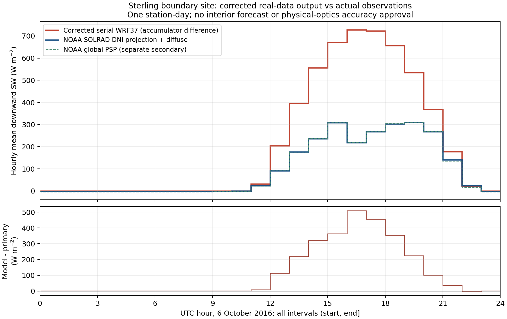

# 수정 실자료 산출물의 실제 독립 비교와 연구 기준선 마감

**현재 고정 직렬 구성의 공학적 구현은 제한된 연구 기준선으로 마감한다.** 기존 음수·KF 수명·지정 경계·재시작·native SW 반환·선택 frozen 상태 수치 검증의 완료를 유지한다. 이번에는 그 수정 cold 하루의 실제 지표 SW 산출물을 **독립 NOAA SOLRAD 측정자료와 비교**했다. 같은 Mie·column·무변경 하루 실행은 반복하지 않았다.

Sterling 한 경계 지점에서 모델은 관측보다 지표 SW 하향복사를 크게 과대 예측한다. 아래 결과는 실제 수정 궤적의 외부 대조이며, 기존 PR65-era 4/37 결과를 최신 구성으로 재명명한 것이 아니다. 이 차이만으로 RRTMGP 광학·구름·공통 host·측면 forcing 중 원인을 정할 수 없고, 계수 조정의 근거로 사용하지 않는다.

| 현재 수정 WRF37 − 주 참조 | 24시간 전체 | 주간 12시간 |
|---|---:|---:|
| 모델 평균, W/m² | 211.1903 | 422.3806 |
| 측정 평균, W/m² | 98.1249 | 197.2507 |
| 평균 편차, W/m² | **+113.0654** | **+225.1299** |
| MAE, W/m² | 113.3353 | 225.6697 |
| RMSE, W/m² | **198.9082** | **281.2969** |
| 최대 시간별 절대차, W/m² | 509.9507 | 509.9507 |

전체 UTC 하루의 모델 적분은 **18.246844 MJ/m²**, 주 참조 적분은 **8.477990 MJ/m²**이다. 야간의 음의 측정 offset을 보존하므로 주간 참조 적분 8.521232 MJ/m²와 전체 적분은 다르다. 별도 global PSP 비교도 전체 bias +114.3922, 주간 bias +225.3831 W/m²로 같은 과대 방향이다. 이 채널을 주 참조 대신 넣거나 결측을 채우지 않았다.



## 사전에 고정한 대상과 실제 자료

`plan.json`은 현재 점수를 계산하기 전에 대상·기간·측정 조합·QC·시간/격자·판정 범위를 고정했다. 기간은 수정 cold 실행과 동일한 **2016-10-06 00:00–2016-10-07 00:00 UTC**이다. 기존 전체 적격 station inventory에서 2016년 자료가 확인된 유일한 영역 내 SOLRAD station Sterling을 재사용했다. Oak Ridge/Tallahassee는 운영 종료 근거가 있고, 영역 밖 SURFRAD를 가장자리 점에 붙이지 않는다. 현재 점수를 보고 station·격자·시간을 옮기지 않았다.

기존 공식 다운로드의 `ste16280.dat`, `ste16281.dat` 원본과 문서·다운로드 receipt의 해시를 재사용한다. 새 관측 다운로드나 새 기상 사례를 주장하지 않는다. 원자료의 첫 줄·좌표·22열 schema·일자·UTC·중복·유한성·QC를 실제로 재판독했다. 10월7일 00시 마지막 minute가 필요하므로 두 번째 파일을 포함한다.

[NOAA의 실제 2016년 Sterling dataset](https://gml.noaa.gov/data/dataset.php?item=ste-solrad-2016)은 minute-average in-situ solar radiation 자료이며 CC0로 공개돼 있다. [SOLRAD README 원문](../solrad-boundary-site-48h/sources/README_SOLRAD.txt)과 [공식 경로](https://gml.noaa.gov/aftp/data/radiation/solrad/README_SOLRAD.txt)를 함께 연결한다. Hicks, DeLuisi and Matt (1996), *The NOAA Integrated Surface Irradiance Study (ISIS)—A New Surface Radiation Monitoring Program*, BAMS 77, 2857–2864를 NOAA의 요청에 따라 인용한다.

## 시간·QC·공간 지원 범위

주 참조는 `DNI × max(cos(제공된 SZA),0) + DHI`이다. 2015년 이후 1분 cadence와 period-end 표기를 적용해 각 시간 **(start,end]의 60개 QC0 minute 모두**를 요구한다. 00시 시작 sample은 제외하고 다음날 00시 sample은 포함한다. 측정 DNI/DHI/global의 음수는 자르지 않는다. 태양 방향의 수평 투영만 수평선 아래에서 0으로 둔다. 제공된 period SZA를 사용한 평균값 조합이며 순간 DNI와 cos의 곱을 완전하게 시간 적분했다고 주장하지 않는다. 주간은 제공된 SZA<90°인 minute가 30개 이상인 시간으로 고정했다.

모델은 실제 `ACSWDNB` 25개 endpoint의 차이를 3600초로 나눈다. 원 history의 units는 J/m², 저장형은 REAL32이며 subtraction은 Python 배정밀도로 수행한다. 시간별 순간 `SWDOWN`은 점검용으로 보존하고 점수에 사용하지 않는다. 현재 driver의 `ACSWDNB += SWDNB*DTaccum`, `DTaccum=DT` 경로에 연결하며, 10분 복사 호출 사이 유지된 실제 모델 flux의 누계를 비교한다. 야간은 실제 accumulator 차이이며 관측이나 모델 결측을 0으로 채운 것이 아니다.

실제 99×90 Mercator 좌표에서 station (38.97203°N, −77.48690°E, 85 m)에 가장 가까운 격자는 **1-based (i,j)=(37,97)**이다. 거리 약 9.006 km, 모델 HGT=101 m, 격자간격 27 km이다. 북쪽 끝에서 두 셀이므로 `spec_bdy_width=5`인 측면경계 완화띠 안이다. **독립 측정값과의 비교는 유효하지만 내부영역 예보 성능을 검증한 결과는 아니다.** 기존 선정과 실제 전체 좌표로 같은 nearest cell을 재확인한다. 관측의 독립성은 모델과 별개인 측정자료라는 뜻이며 별도 독립 기상 사례를 뜻하지 않는다.

## 불확실도와 수용판정

후보–참조 차이와 불확실도를 분리한다. QC0는 교정된 참값이나 0 불확실도를 뜻하지 않는다. 주/보조 측정 채널의 차이는 함께 보고하지만 교정 불확실도의 상계로 쓰지 않는다. 두 채널 모두의 동일한 오차 방향도 특정 과정의 인과적 귀속은 아니다.

REAL32 누계 endpoint의 반 ULP 합을 시간으로 나눈 **표현 규모**는 각 시간에 보존한다. 이것은 매 step 누계의 산술 오차·복사 적분 오차·모델 수치오차의 총상계가 아니다. 배정밀도 subtraction으로 원 REAL32 누계의 반올림을 복원할 수 없다. 기기 교정 불확실도, point/27-km cell·지형·시간·분광 지원의 대표성, 총 수치오차, 사용 목적의 허용량은 정당화된 수치가 없으므로 `null`이다. 예를 들어 SOLRAD 기기의 280–3000 nm 감응과 모델 broadband를 정확히 같은 분광 측정으로 인증하지 않는다.

**판정:** 이 목표량의 실제 독립 비교는 완료다. 고정 구성을 제한된 experimental 연구 기준선으로 유지한다. 해당 station-day의 과대 예측을 보존하고, 정량적 예보 수용은 사용 목적에 근거한 허용량·불확실도 없이 승인하지 않는다. 한 경계 지점으로 일반 예보 정확도나 내부영역 skill을 승인하지 않는다. 결과보다 조금 큰 tolerance를 사후에 정하지 않으며, 반경·수농도·CF·물성·태양상수의 조정을 제안하지 않는다.

기존 잔여 물수지, RFMIP/LBLRTM, 실제 wet/melting hail 물성·PSD·발생분율, 전체 에너지 조건은 이 비교와 별도다. 구현 마감은 이 조건들을 PASS로 바꾸는 의미가 아니다. 반대로 이 미승인으로 이미 해결된 경계·음수·재시작을 다시 미완료로 되돌리지 않는다. 이전 48시간 구 구성 점수와 기간·정책이 다르므로 이번 결과로 직접 개선율이나 4/37 우열을 계산하지 않는다.

## 고정한 공학 기준선과 실행 identity

Main `001834648e80efc633562a17cba2b290f49b33b8`, tree `ae48354d312b0e98903525076d5e9309ecf75d50`의 고정 범위는 단일 영역·직렬 one tile, UDM27/LW37/SW37, number1/population0, scalar_adv_opt0, capacity0/liquid-size0, dt60/복사간격600초, 기존 experimental frozen1 및 같은 표다. UDM population0와 CU population1은 구분한다. 다른 물리 조합·MPI/OpenMP·warm 연구 옵션의 동시 실자료 지원으로 확대하지 않는다.

현재 평가한 대형 NetCDF는 기존 수정 cold 하루의 파일 해시 `3da760fb50fa18b5ead1248ca684f72e22625524896d37a1bc2aa432c01fd72c`, 1,200,361,076 bytes에 정확히 연결된다. 원 하루 receipt·실행파일·namelist와 source pin을 이전 `vapor-first-operation` 근거에 연결하고, 기존 450쌍 재시작·최종 단계 비음수·KF 만료율 PASS, SW 144회 전 영역 반환, 선택 frozen16밴드 참조의 완료를 재사용한다. 기존 결과를 새로 실행한 것처럼 집계하지 않는다.

이번에는 **실제 native NetCDF를 로컬에서 새로 읽고 추출·비교**했다. `extraction-receipt.json`에 PID·완료시각·실행 소스·원 파일 해시를 저장한다. 이 대형 파일 자체는 번들하지 않는다. Portable CI는 추출된 모델 series/실제 좌표와 기존 원 NOAA 자료를 재생하며, NetCDF를 새로 연다고 주장하지 않는다. 새 WRF·REAL·Mie·RTE·Fortran build 프로세스는 **0회**다. 생산 코드·기본값·계수·기존 일곱 조건은 그대로다.

## 재생

```sh
python3 -I -S validation/rrtmgp37/real-output-independent-comparison/verify_saved.py
python3 -I -S validation/rrtmgp37/real-output-independent-comparison/test_saved.py
```

표준 라이브러리만으로 원 관측을 다시 파싱하고 시간별 값·점수를 재계산한다. `result.json`, `hourly-comparison.csv`, 그림은 같은 결과를 담는다. 그림 재생에는 Matplotlib, 원 NetCDF 재추출에는 NumPy/netCDF4와 hash가 같은 retained file이 필요하다. `extract.py`는 덮어쓰기를 거부하며 모델을 실행하지 않는다.

의미 반례 7개는 관측 결측/QC 시 PSP 대체 금지, midnight 시간 지원, 음의 측정 보존, 순간 flux와 평균의 구분, 시간 이동/누계 reset, 경계의 내부영역 승격, 사후 tolerance 승격을 확인한다. 과학적 승인을 보류한다는 문서만 추가한 것이 아니라 실제 1,440분과 수정 모델의 24개 시간 구간을 대조한 결과다.

로컬 저장 재생·의미 반례7개·acceptance39개·acceptance index가 통과했다. 기존 NOAA parser/NumPy로 별도 재계산한 24개 주 참조 시간평균은 모두 같았고, bias/RMSE도 산술 정밀도 안에서 일치했다. 이는 같은 원자료의 분석 교차검사이며 새로운 독립 관측이나 모델 실행이 아니다.

후속 분석에서 `ulp32(0)`의 지수 처리 오류를 수정했다. Binary32의 0 간격은 2⁻¹⁴⁹이며 기존 코드는 `frexp(0)` 때문에 2⁻²⁴를 사용했다. 수정은 0 누계 endpoint의 보조 표현 규모12시간에만 영향을 준다. 원래 모든 편차·RMSE·적산·그림·최대 표현 규모는 같으며, zero/normal/subnormal 검사를 추가해 이 패키지 의미시험은 현재8개다. 원 모델 결과나 물리 정책의 변경이 아니다.
