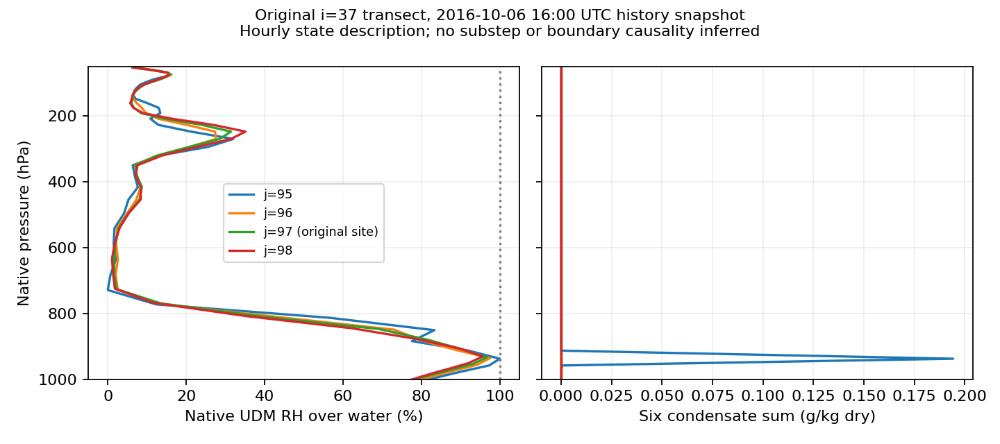

# Sterling 경계 기여 판정과 내부영역 입력 준비

**16–17 UTC 원 지점에서 응결물을 직접 제거한 완화 경향은 없었다. 실제 forcing의 응결물은 미제공 기본 0이며, 외부모델의 물리적 청천으로 인증할 수 없다.** 이번 조치는 광학·CF 조정이 아니라 **같은 관측소를 충분히 내부에 두는 별도 단일영역 입력의 생성**이다. 초기장·측면경계·number 계약을 만들고 기존 public WRF의 한 step 사전 실행까지 완료했다. 새 영역의 하루 예보 성능은 아직 평가하지 않았다.

기준 main `1fcffbbeea099839cce83ba2b3725d3de4543f5a`, tree `3970b8b68656ad6f0d10c7ddd3bc5b288e53e77d`. 기존 직렬 포팅·경계·비음수성·재시작·SW 반환·조건부 frozen 계산과 #199–200 비교 구현은 완료로 유지한다. 생산 WRF·UDM·RTE, 기본값·계수·보호조건·기존 일곱 종료 조건은 변경하지 않았다.

## 실제 5점 연산의 판정

기존 수정 cold의 11:58 checkpoint에서 17:00까지 한 번 재개했다. 동일 초기장·경계·물리·dt60초·복사600초이며 namelist 변경은 시간·IO뿐이다. 실제 수분 완화는 **RK1(dt_rk20초)**에서 경향을 만들고, 그 경향은 **RK3의 PD source 사전갱신(dt60초)**에서 사용한다. 세 RK predictor를 독립 물리 시간으로 합산하지 않는다.

원 지점 i=37,j=97은 source [57,600,61,200)초의 **60개 step×44층×7종**을 읽었다. j=95,96,98은 여섯 600초 phase에서 읽었다. 실제 북쪽 core의 호출 범위는 **j=96–98**이다. `FCX(5)=GCX(5)=0`은 실제 배열에 존재하지만 **j=95에는 core 호출 자체가 없다.** 가정한 계수표를 실제 호출 범위로 대체하지 않는다.

| 실제 런타임 항목 | 값 |
|---|---:|
| spec_zone / relax_zone / spec_exp | 1 / 4 / 0 |
| j=97의 FCX, s⁻¹ | 0.0011111111380159855 |
| j=97의 GCX, s⁻¹ | 0.00022222223924472928 |
| 5점 error 피연산자 재구성 | 110,880개 일치 |
| REAL32 raw 완화 경향 갱신 재구성 | 22,176개 일치 |
| 실제 전체 PD source 갱신 재구성 | 24,024개 일치 |
| 관측 실행 대 원래 cold | **225배열×6시각=1,350쌍 바이트 동일** |

기록은 실제 압력 결합량 S, 파일 B와 BT, dtbc, 다섯 error, F/G, 호출 전·후 경향과 wrapper가 수용한 경향을 포함한다. `E=B+dtbc×BT−S`와 `T_after=T_before+F E0−G(EW+EE+EN+ES−4E0)`를 native REAL32 순서로 재현한다. 0차항·공간항은 실제 피연산자의 별도 float64 진단이며, 두 진단값을 합쳐 native 반올림 결과와 같다고 요구하지 않는다.

| 원 지점의 응결물 source 표본 | 결과 |
|---|---:|
| 여섯 종의 core 입력 중심 S>0 | 0 |
| 수용된 음의 응결물 증분 | **0** |
| QRAIN 양의 증분 | **218 / 2,640** |
| QRAIN 최대 증분, Pa·(kg/kg dry)·s⁻¹ | 3.4996850573×10⁻⁷ |
| 나머지 다섯 응결물 증분 | 모두 0 |

j=96에서도 QCLOUD 6개, QRAIN 32개의 양의 증분이 있었고 음의 응결물 증분은 없다. 여기는 여섯 phase의 264층 표본이므로 원 지점의 60-step 시간적분과 혼합하지 않는다. **0 목표가 항상 제거 source가 되는 것은 아니라는 관계를 실제 5점 값으로 확인했다.** 미세한 비 source가 후속 과정에서 어떻게 바뀌는지까지 이번 관측으로 귀속하지 않는다.

QV의 source 부호는 혼합돼 있다(원 지점 양1493/음1147). wrapper의 QV 과제거 제한은 이번 표본에서는 작동하지 않았다. 수증기·열역학·이류를 통한 간접 경계 영향, 그 이전의 구름 형성 부족은 배제하지 않는다. **해당 한 시간의 직접 응결물 제거 조사는 종료**하고, 이 결과를 하루·전체 영역의 경계 인과성 부정으로 확대하지 않는다. Pa 결합 경향을 kg/m² 물수지로 표시하지 않는다.

## 0 입력의 출처

실제 로컬 NetCDF와 전지구 WPS 중간자료를 읽었다.

1. 원 tutorial `met_em` 아홉 파일에는 QC/QR/QI/QS/QG/QH 및 해당 제공 flag가 없다. 새로 확보한 전지구 `FILE:*` 아홉 파일에도 이 응결물 field가 없다.
2. 원 REAL의 optional-input reader는 누락 flag를 0으로 두며, 응결물 수직보간은 해당 flag가 1일 때만 실행한다. retained REAL의 이 구간은 현재 소스와 같고 optional reader 전체도 같다. **원 REAL 출력의 여섯 응결물·측면 값/경향은 이미 정확히 0**이다.
3. 이후 exact-zero metadata 생산기와 S_eta 계약 생산기의 **모든 변수 배열은 원 REAL과 동일**하다. 생산기가 비영 응결물을 삭제한 결과가 아니다.

따라서 분류는 **“실제 effective preprocessing 자료에 미제공 → 원 REAL 기본 0”**이다. 원 GRIB에 어떤 cloud parameter가 있었는지까지 입증하거나, raw FNL이 물리적으로 청천이었다고 주장하지 않는다. 원 GRIB archive도 확보·해시·보존했지만 cloud parameter decoding을 수행하지 않았다.

[공식 Matthew ungrib 안내](https://www2.mmm.ucar.edu/wrf/OnLineTutorial/CASES/SingleDomain/ungrib.php)의 FNL/GFS·6시간·Vtable.GFS 계보, [공식 metgrid 안내](https://www2.mmm.ucar.edu/wrf/OnLineTutorial/CASES/SingleDomain/metgrid.php)의 자료를 사용했다. 원 `met_em.tar.gz` SHA256은 `3542bd5db813b454258a6a67d4ebff95cbbc10252b8bffede0b9dacf1ccc5960`이다. 내려받은 global intermediate·지형·raw GRIB의 URL/응답/전체 SHA와 안전 해제 목록을 archive에 보존한다.

## 기존 시간별 상태 재사용

15–19 UTC, 고정 i=37,j=89–99의 **2,420층 표본**을 읽었다. history의 **T는 dry perturbation potential temperature**, THM은 별도 변수다. T+300, P+PB, native R_d/cp로 실제 온도를 구하고, 현재 UDM의 변경하지 않은 180–330 K SVP table/functions를 추출·컴파일해 수면/해당 상의 포화 혼합비를 계산했다. native phase는 273.16 K 아래 ice, 그 위 water이며 따뜻한 층의 ice 물성을 외삽하지 않는다.

원 지점의 시간별 최대 RH_water는 15/16/17/18/19 UTC에 각각 **96.17/96.68/96.69/96.59/94.09%**다. 이는 원 지점의 미포화 상태를 보여 주지만 substep UDM 생성률이나 그 원인을 확정하지 않는다. 더 안쪽 j95에는 포화에 가까운 층과 응결물이 있다.



## 결정한 조치: 내부영역 검증 입력

잘린 기존 `met_em`을 padding하거나 행을 복제하지 않았다. 공식 **전지구 중간자료 → WPS v4.6.0 geogrid/metgrid → retained REAL → 기존 exact-zero/S_eta 생산기**를 실제 실행했다. WPS commit은 `335c76a111f84503e8b963abaf273ea8053645bb`다. retained REAL은 기존 자료의 생산 실행파일을 그대로 재사용했으며 현재 전체 WRF clean build라고 주장하지 않는다.

| 구성 | 기존 점수의 영역 | 별도 준비 입력 |
|---|---:|---:|
| Mercator, 27 km, ref28N/75W | 동일 | 동일 |
| e_we × e_sn | 91 × 100 | **91 × 144** |
| 같은 Sterling 관측소의 최근접 격자 | (37,97) | **(37,119)** |
| 격자 위·경도 / 관측소 거리 | 기존 값 | **같음, 9.006 km** |
| 북쪽 물리 경계 거리 | 2셀 | **24셀** |
| number / population / 계약 | 1 / 0 / 1 | 동일 |
| 사전 실행 | 기존 하루 | **변경 없는 public WRF 60초 1 step 완료** |

관측소 좌표·UTC·QC·원래 점수는 유지했다. 같은 위·경도의 셀이 안쪽으로 이동했으며 잘 맞는 이웃으로 점수를 바꾸지 않았다. 한-step 출력의 수분7종/number3종은 비음수·유한하다. 이 검사는 입력 표현·시작 경로 확인이며 장시간 안정성·재시작·관측 정확도 검증이 아니다.

**입력 사용 계약:** 여섯 응결물의 초기·측면 기본 0을 명시한 연구 forcing으로만 사용한다. 외부모델의 유효한 응결물 예측값으로 승인하지 않는다. 기존 pressure-coupled number·별도 CCN 계약과 guard를 유지한다. `input-use-decision.json`에 파일 hash와 제한을 고정했다.

공식 [저해상도 필수 지리자료](https://www2.mmm.ucar.edu/wrf/users/download/get_sources_wps_geog.html)는 교육·시험용이다. 새 구성은 영역뿐 아니라 WPS4.6(원 METGRID4.3)·lowres 정적 지리자료도 달라질 수 있다. 따라서 후속 차이는 **별도 구성의 결과**이며 RRTMGP 광학 코드만의 개선율이 아니다. 같은 사례를 내부에 둔 연구 검증에 적합한 기하·표현을 확보했지만 일반 예보 적격성은 미승인이다.

`saved/interior-input.tar.gz`에는 실제 encoded `wrfinput_d01`, `wrfbdy_d01`, 보존 배열 검사 결과와 **원래 24시간·물리 설정에서 e_sn만144로 바꾼 forecast namelist**가 있다. 실행계수·public 실행파일은 기존 로컬 기준선의 외부 의존성으로 유지하므로 이 묶음만으로 독립 설치가 완결되지는 않는다. 현재 workspace의 `build/udm37-sterling-interior-real-v1/encoded/`에서도 파일을 사용할 수 있다. **새 영역 24시간 예보나 새 점수는 아직 없다.**

## 수행 범위와 저장 재생

실제 WRF는 원 사례 제한 관측1회와 새 입력 60초 사전 실행1회, REAL1회다. 최종 geogrid1회·metgrid1회가 성공했다. standalone RTE/Mie, 새 하루 예보·재시작 캠페인은 없다. 증분 관측 build는 compile3/archive1/link1이며 전체 clean build가 아니다. saturation은 추출한 native 스칼라 함수만 실행했으며 public UDM 전체를 독립 실행한 것으로 집계하지 않는다.

개발 중 source-anchor 실패(컴파일 전), 사용하지 않은 v2 관측 build, WPS csh 부재·OpenMP I/O 링크, geogrid의 긴 경로와 lowres selector 미지정, saturation parameter 추출 오류가 있었다. 최종 실행에 앞서 수정했고 실패/미사용 근거는 development로 보존한다. 생산 수식이나 자료 값을 맞추는 수정은 없었다.

```sh
python3 -I -S validation/rrtmgp37/sterling-boundary-forcing-decision/verify_saved.py
python3 -I -S validation/rrtmgp37/sterling-boundary-forcing-decision/test_saved.py
```

표준 라이브러리 재생은 실제 operands·경향·PD 갱신·1,350배열 hash·입력 계보·내부 지점·파일 연결을 검사한다. 큰 원 history는 로컬에서 실제로 판독했고 비교 inventory를 보존했다. CI는 원 history 재판독·WPS·WRF 실행을 하지 않으며 `new_model_runs=0`이다. 7개 의미 반례는 이웃/계수/누락/잘못된 source dt/미제공값의 청천 승격/경계점의 내부 승격/배열 변경을 거부한다. 기존 최상위 종료 조건은 늘리지 않았다.

원래 하루 평균 SW 편차 **+113.0654 W/m²**, 주간 **+225.1299 W/m²**와 모든 점수는 유지한다. 이번 판정은 큰 과대모의를 해결했다는 주장이 아니다. 직접 제거를 이 한 시간의 원인으로 계속 추적하지 않고, 실제로 준비한 내부 구성의 고정 기간 비교와 상태 형성 평가로 이동하는 근거다. 일반 물·에너지 보존, wet/melting hail, RFMIP/LBLRTM 및 관측 성능 승인은 기존처럼 보류한다.

로컬 최종 저장 재생·신규 의미 반례7개·acceptance41개·기존 index가 통과했다. index의 과거 startup source 비교 불일치와 기존 reference FAIL은 그대로 유지하며, 이번 패키지의 현재 source pins와 구분한다.
