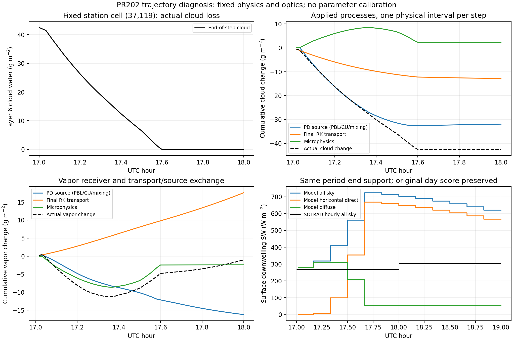

# Sterling 17–18 UTC 구름 소실: 실제 연산 귀속과 적용범위 결정

PR202의 수정 내부영역 cold를 유지했다. 같은11:58 checkpoint를19:00까지 한 번 재개하고, 원 관측소의1-based `(37,119)`에서16:50–18:10에만 실제 연산을 기록했다. 생산 WRF·UDM·RTE 소스, 입력, 물리 정책과 광학계수는 변경하지 않았다. 새24시간 실행은 없다.

**결정: 현재 생산 코드와 계수는 유지하고 이 국소 원인 조사를 종료한다. 현재 구성은 제한된 직렬 연구 기준선으로 유지하되, Sterling 오후 구름 지속성과 지표 전천 SW의 정량 예보에는 승인하지 않는다.** 이번 자료가 지지하는 것은 PBL 재분배·수송·후속 증발의 실제 연결이며, 광학 배율이나 새 limiter의 필요성이 아니다. PBL이 모의한 구름장 자체의 정확도는 독립 대기 자료가 필요한 별도 과학적 질문이다.

## 처음 감소한 연산과 마지막 소실 연산은 다르다

| 실제 구간 UTC | native6층의 확인 결과 |
|---|---|
| 17:00–17:01 | 선언한 한 시간의 첫 감소. 최종RK 수송−0.559398 g/m², PD source−0.017894, 미세물리+0.059977 |
| **17:02–17:03** | **가장 큰 step 감소−1.668147 g/m². PBL−1.889563, 수평 확산−0.014363, 최종RK 수송−0.547207, 미세물리+0.782987** |
| **17:35–17:36** | **미세물리 직전 잔여0.696734 g/m²가0으로 전환. 수증기+0.696775 g/m², 기온 약−0.00916 K, 지표 RAINNC 증가0** |

가장 큰 감소 step의 PBL은6층에서 약1.88956 g/m²를 빼고1–5층 등에 거의 같은 양을 더했다. 기주 PBL 구름물 합은+0.000477 g/m²다. 5층에는 미세물리 직전 구름물이 존재하고, native 수면RH0.973343의 상태에서 그 호출 뒤0이 되며 수증기가 증가하고 기온이 낮아진다. 반면 같은 호출의6층은 RH1.001197에서 응결해 구름물이 증가한다. 이를 모두 “6층 현지 증발”로 묶으면 서로 반대인 연산을 혼동한다.

17:35 source의6층 RH는 미세물리 전0.998900, 후0.999960이다. 최종 소실 이후18:00까지 해당 층의 end-of-step 구름물은0이다. 증발·응결의 donor/receiver와 냉각·가열 부호를 실제 상태에서 확인했으며, 미세물리 내부의 모든 gross 반응률이나 잠열 에너지 폐합을 측정한 것은 아니다.

## 같은 한 시간의 실제 물질량 장부

단위는 g/m². 실제 native REAL32 압력 결합계수 `a=C1H*(MU+MUB)+C2H`와 `-DNW/native_g`를 이용해 diagnostic REAL64로 `mass*q`를 계산했다. Pa 경향을 kg/m²로 바꿔 부르거나, 층질량을 고정하지 않았다. 각각 REAL32로 반올림한 기존 hourly 층질량 곱과 마지막 비트까지 같다는 주장은 하지 않는다.

| 항목 | 구름물6층 | 구름물기주 | 수증기6층 | 수증기기주 |
|---|---:|---:|---:|---:|
| 실제 상태 변화 | **−42.497399** | **−42.497399** | **−1.026991** | **+1207.105494** |
| PBL 경향 적분 | −32.969300 | +0.005800 | −18.340405 | +0.052965 |
| CU 경향 적분 | 0 | 0 | 0 | 0 |
| 수평 확산 경향 적분 | +1.034855 | +1.382519 | +2.112658 | +61.394418 |
| 실제 최종RK 수송 증분 | −12.847389 | −12.096561 | +17.611330 | +1113.834687 |
| 미세물리 상태 증분 | **+2.284436** | **−31.789155** | **−2.410816** | **+31.821919** |

PBL·확산은 source 적분이며 PD 실제 갱신과의 반올림 차이도 결과에 별도로 남긴다. 최종RK 수송은 source 사전갱신 뒤의 base를 사용한 실제 상태 증분이다. predictor3개를 독립60초로 더하지 않았다.

6층 구름물의 순손실은 주로 PBL 재분배와 수송이다. 기주 구름물에서는 다른 층으로 옮겨진 물의 후속 증발과 수평 순수송이 중요하다. 구름물 수송의 기주 수직 성분은 약−3.6e−8 g/m²이며 x/y 성분은−19.075413/+6.978856이다. 6층만 보면 수직 수송도−2.549376 g/m²로 비영이다.

같은 시간의 일곱 종 총수분은6층에서−43.577602 g/m², 기주 전체에서는 **+1164.527759 g/m²**다. 한 층의 감소를 전체 물손실로 해석할 수 없다. 기주 미세물리 총수분 변화−0.004546 g/m²도 그대로 보존하며0으로 강제하지 않는다. 해당 지점의 미세물리 RAINNC 누계 증가는0이다. 지표 QFX의 고빈도 독립 장부와 전체 영역 에너지 폐합은 이번 국소 관측의 산출물이 아니므로, 전체 보존성은 승인하지 않는다.

고정7×7 이웃의6층 양의 QCLOUD 셀은17시11개에서18시5개로 줄었다. 다른 위치에는 구름이 남지만, 원 관측소의 점수나 격자를 잘 맞는 이웃으로 교체하지 않았다. 이 이웃 관측은1–44층 전체 공간장을 대신하지 않는다.

## 구름 소실 뒤 실제 직달·산란 반환

| period-end 시간평균 W/m² | 17–18 UTC | 18–19 UTC |
|---|---:|---:|
| 모델 전천 held SW | 500.976115 | 663.836039 |
| 모델 수평 직달 | 298.104987 | **610.170695** |
| 모델 산란 | 202.871124 | **53.665344** |
| 관측 수평 직달 | 1.547011 | **12.168087** |
| 관측 산란 | 266.706667 | **290.465000** |

120개 실제 period-end 값을 적분했고 all/clear 누계240회 및 native diffuse=all−horizontal_direct120회를 정확히 재생했다. 18–19시 held 전천과 청천은 실제로 같다. 기존 ACSWDNB/ACSWDNBC hourly 차분의 약−0.0014 W/m² 차이는 각각의 REAL32 누계 경로에 남아 있으며, 이를 복사 감쇠나 새로운 오차로 바꾸지 않는다. 관측 UTC·QC·분별 DNI cosine 투영 규약과 PR202 전체시간·주간 점수는 그대로 유지한다. 모델 청천값을 관측 전천값과 비교해 청천 정확도를 승인하지 않는다.



## 실행 근거와 재생

- 실제 제한 재개1회:11:58–19:00,422step. 관측 연산은16:50–18:10의80step, 중앙44층 일곱 종과 필요한 이웃에 한정했다.
- **원 cold와225배열×8시각=1800쌍 바이트 동일.** source·계수·입력 pin과 실제 PID/returncode를 보존했다.
- PD source 갱신24,640개, 최종RK 갱신24,640개, 제한된 공유면의 z/x/y 발산73,920개를 native REAL32 연산 순서로 정확히 재생했다. `tenddec`를 켜거나 실제 경향을 새로 계산해 사용하지 않았다.
- private observer 증분 build는 compile4/archive1/link1이다. 원본 소스의 모든 비어 있지 않은 행이 순서를 유지하며 남아 있고, 추가된 관측의 입력은 읽기 전용이다. public 생산 소스는 변경하지 않았다.
- native saturation은 기존 UDM table/functions만 추출해 compile1/run1했다. 전체 UDM·WRF·Mie·RTE 실행으로 집계하지 않는다.
- 개발 중 source anchor와 receipt 경로 오류는 child 실행 전에 수정했다. 초기 국소 장부의 endpoint-only ULP 검사는 중간량이 끝상태보다 큰 상쇄를 다루지 못했다. 이 비물리적 PASS 검사는 제거했고 **실제 double 재결합 잔차를 그대로 보고**한다. native PD/RK/face의 정확 재생 기준과 물리 허용량은 바꾸지 않았다. 실패·실행 source는 archive development 항목에 보존한다.

실제 원자료·수정 observer source·명령·출력·해시·전체 과정별 장부는 [saved/evidence.tar.gz](saved/evidence.tar.gz)에, 작은 결과는 [result.json](result.json)과 [cloud-loss-steps.csv](cloud-loss-steps.csv)에 있다. archive는 대형 원 NetCDF와 실행파일을 포함하지 않으며 로컬 보존 파일의 hash와 실제 추출을 연결한다. 기존 입력·라이브러리·계수·module 외부 의존성까지 독립 설치를 완결한 묶음은 아니다.

저장 재생은 표준 라이브러리만 쓰며 새 모델을 실행하지 않는다.

```sh
python -I -S validation/rrtmgp37/sterling-cloud-loss-operation/verify_saved.py
python -I -S validation/rrtmgp37/sterling-cloud-loss-operation/test_saved.py
```

이 결과는 연구용 공학적 완료를 유지한다. 기존 일곱 종료 조건·RFMIP/LBLRTM FAIL·frozen1의 실제 wet/melting 입자 적용성·일반 MPI/OpenMP·일반 예보 정확도는 승인하지 않는다. 이번 선택 시간은 기존 결과를 보고 정한 원인 진단 구간이며 독립 성능 시험이 아니다.
