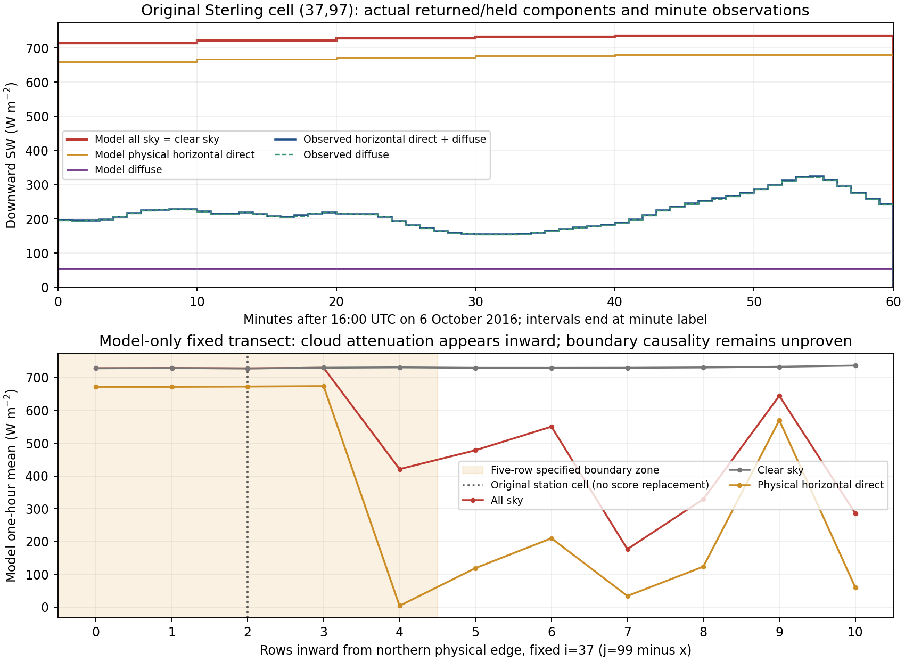

# Sterling 최대 일사 오차 시간의 상태–복사 연결

**16–17 UTC의 원래 지점에서는 실제 소비 구름 입력이 없었고, 모델 전천과 청천 계산이 같았다.** 관측에서는 직달 성분이 강하게 억제됐지만, 모델은 강한 직달 상태였다. 두 행 안쪽에는 양의 구름 입력과 큰 구름 감쇠가 있다. 다음 우선 조사 대상은 이 지역의 구름·차폐 상태 형성과 측면 forcing/완화의 관계다. **구름 입력이 있는데 광학 계산이 이를 빠뜨렸다는 근거나, 광학계수를 교체할 근거는 이 지점에서 확인되지 않았다. 경계가 원인이라고 확정한 것도 아니다.**

기존 포팅·경계·음수·재시작·SW 반환·선택 frozen 수치 참조와 #199 관측 비교는 완료로 유지한다. 원래 지점·QC·24시간 점수를 바꾸지 않았으며, 이웃 격자에 관측을 옮겨 새 점수를 만들지 않았다. 생산 WRF·UDM·RTE, 기본 정책·광학계수·기존 일곱 종료 조건은 그대로다.

## 같은 시간 지원의 실제 복사 성분

대상은 2016-10-06 **16–17 UTC**, 원래 1-based **(i,j)=(37,97)**이다. 관측은 (16:00,17:00]의 원 NOAA 60개 분자료를 직접 읽었다. 모델은 source [57,600,61,200)초의 실제 60초 적용 구간을 읽었다. 여섯 SW 호출의 결과와 그 사이 유지된 flux가 연결된다.

| 한 시간 평균, W/m² | 실제 관측 | 모델의 실제 반환·유지량 |
|---|---:|---:|
| 전천 하향 | 218.288065 | 728.237834 |
| 청천 하향 | 관측 청천 기준 없음 | 728.237834 |
| 수평 직달 | **1.184732** | **672.882395** |
| 산란 | **217.103333** | **55.355438** |
| 직달법선량 | 1.671667 | 972.819527 |

관측 산란 비중은 99.457262%다. 이 분해는 관측의 구름층·상·광학두께를 직접 측정한 결과가 아니며, 구름 외의 차폐 요인까지 배제하지 않는다. 전천 관측을 청천 참값으로 사용해 청천 기체 광학 오류를 계산하지 않는다.

모델 직달은 실제 `swdkdir_predelta`/unscaled 수평 직달에서 읽고, 실제 source μ로 법선량을 환산한 뒤 시간평균했다. 평균 직달에 평균 cosine을 적용하지 않는다. 관측도 매 minute의 DNI와 제공된 SZA를 먼저 곱한다. 측정의 음수나 보조 PSP를 임의로 자르거나 대체하지 않았다. 관측 PSP 평균은 219.248333 W/m²로 별도 유지한다.

원래 `ACSWDNB` 끝값으로 얻은 **728.238750 W/m²와 오차 +509.950685 W/m²는 그대로**다. 위 실제 held 평균과의 −0.000916341 W/m² 차이는 REAL32 누계 산술 때문이다. 실제 각 60초의 `fl(A+fl(F×DT))`를 전천·청천 모두 재생했으며, 단면 11기주의 **1,320개 누계 갱신과 원래 16·17시 끝값이 정확히 같다.** 이 작은 산술 차이를 새 성능 점수나 보정으로 사용하지 않는다.



## 실제 입력과 소비 지점을 연결했다

기존 history는 15–19 UTC 시간별 CLDFRA·수분 7종·청천/전천 누계·순간 성분을 제공하지만, 호출 사이의 실제 입력과 직달 시간평균은 제공하지 않았다. 따라서 고정한 수정 cold의 **11:58 checkpoint에서 17:00까지 한 번만** 재개해 read-only 관측을 보강했다. 실제 source 57,600·58,200·58,800·59,400·60,000·60,600초에서 입력을 읽었다.

기록 지점은 실제 native/CU 경로를 만든 뒤 batch에 넣기 직전, 실제 반환을 native 배열로 scatter한 직후, `radiation_driver`가 반환한 뒤다. 기존 수치 대입은 유지하고 `INTENT(IN)` 관측 호출만 private copy에 추가했다. GPU/새 광학/계수 대입을 사용하지 않았다.

| 선정점 실제 관측 | 여섯 호출의 결과 |
|---|---|
| 실제 소비 CF, RAD CF source | 모든 native 층에서 **0** |
| wrapper가 받은 여섯 응결물 | 모두 **0** |
| native grid 물경로, radiation 물경로 | 여섯 종 모두 **0** |
| CU grid·in-cloud 물경로 | 두 상 모두 **0** |
| 반환 전천−청천 flux | 매 호출 **0** |
| 별도 UDM CF 진단 필드 | **1**, 이 경로의 소비 CF로 사용하지 않음 |

마지막 행은 지우거나 소비 CF와 같게 보정하지 않았다. 현재 public wrapper는 `cldfra1d → cldfrac → gp_batch%cf`를 소비하며, optional `udm_cldfra`는 이 경로에서 진단으로 기록된다. **UDM population0와 CU population1도 구분**한다. 별도 CF 필드가 1이라는 사실만으로 cloudy 입력이 solver에 전달됐다고 해석하면 안 된다.

초기 후처리의 과도한 assertion은 이 비소비 UDM CF까지 0이어야 한다고 요구해 실패했다. 실제 기록과 source를 확인한 뒤 소비 CF·물경로만 검사하도록 바로잡았다. 첫 분석 코드·로그는 development 근거로 보존하고, 모델 재실행 없이 동일 기록을 재분석했다. 새 생산 결함이나 모델 실패로 재명명하지 않는다.

## 고정 단면과 경계 대표성

관측점과 동일한 i=37에서 **j=99→89**의 고정 북쪽 단면을 사용했다. 폭5의 지정 경계 구역과 내부를 함께 보며, 관측과 가장 잘 맞는 점을 고르는 규칙이 아니다. 아래 값은 모두 **모델 단면 진단**이다.

| j / 북쪽 가장자리로부터 셀 수 | 전천 held, W/m² | 수평 직달 held, W/m² | 원 누계의 전천−청천, W/m² |
|---|---:|---:|---:|
| 99 / 0 | 728.679 | 672.076 | 0 |
| **97 / 2, 원래 지점** | **728.238** | **672.882** | **0** |
| 96 / 3 | 730.190 | 674.135 | 0 |
| 95 / 4 | 421.021 | 4.060 | −310.338 |
| 94 / 5, 완화띠 밖 | 478.529 | 119.159 | −251.309 |
| 92 / 7 | 176.830 | 33.959 | −553.204 |

안쪽의 양의 CF/물경로와 같은 기주의 청천–전천 감쇠는 실제 기록으로 연결된다. 따라서 이번 문제를 “어디에서나 구름 광학이 투명하게 계산된다”로 설명할 수 없다. 그러나 서로 다른 기주의 상태·지형·유입·구름도 다르므로, 단면 변화만으로 경계의 인과 효과를 수치로 분리한 것은 아니다.

원래 12·18 UTC 북쪽 경계 기록의 여섯 응결물 값·시간경향도 0이다. 수증기는 별도로 보존했다. 파일의 `units`만 보고 이를 자동으로 비결합 mixing ratio로 해석하지 않고 **raw 저장 표현**으로 기록한다. 0의 사실은 유지되지만, 경계 완화가 실제 구름을 얼마나 제거했는지는 직접 관측하지 않았다. 경계에 응결물이 0이라는 사실도 내부 구름 형성이 불가능하다는 뜻이 아니다.

**판정:** 원래 지점에는 실제 입력 단계부터 cloud/CU 물경로가 없고, 안쪽에는 구름과 감쇠가 존재한다. 다음은 구름·차폐 상태와 북쪽 유입/완화·상태 진화를 우선 조사한다. 필요하면 관측점이 완화띠 밖에 놓이는 별도 구성으로 대표성을 검증한다. 그 실행은 새 영역/forcing 궤적이며 광학 코드 수정의 개선율로 부르지 않는다. 원래 경계 지점 점수는 계속 보존한다. 광학·CF·반경·수농도·태양상수 튜닝이나 새 물리 policy는 정당화되지 않는다.

## 원래 모델 궤적과 점수 보존

새 실행의 12·13·14·15·16·17시 **225개 배열×6시각=1,350쌍이 원래 수정 cold와 바이트 동일**하다. 새 관측과 지정 시각 재개가 이 평가 구간의 보이는 모델 상태를 바꾸지 않았음을 확인한 것이다. 과거 MU halo 재시작 원인을 다시 조사하거나 모든 재시작 지원을 새로 인증한 캠페인이 아니다.

기준 main `0aadad812e5fffdb99d3bf0c34ea5429e4b26487`, tree `b072c653b57a233df9f89426f14f4b6190ad45fc`의 기존 직렬 one-tile 구성, dt60·복사600초·number1/population0·capacity0/size0·experimental frozen1과 같은 initial/forcing/계수를 유지했다. 변경된 namelist는 재개/종료/IO 시각뿐이다. 기존 공학적 마감과 frozen/전체 물·에너지·관측 정확도 미승인은 유지한다.

실제 신규 작업은 **증분 compile3개·archive1개·link1개, 제한 WRF1회(18,120초)**와 원 history/경계 재판독이다. 독립 기상 사례는 같은1개다. 목표 구간 SW6회와 선택11기주/2,904층 표본/660held 기주-step을 기록했으며, 이를 전체 host 엔진 호출 수나 독립 사례 수로 합산하지 않는다. 새 standalone RTE·Mie·24시간 캠페인은 없다. 기존 archive를 재사용한 증분 build이며 clean-checkout 전체 WRF build를 주장하지 않는다.

원 native NetCDF와 경계는 로컬에서 직접 읽었다. Archive에는 private source·실제 command receipt·checkpoint/initial/forcing/executable pin·기록·비교 hash를 보존한다. Portable CI는 큰 NetCDF를 새로 열거나 모델을 실행하지 않는다. standalone 기존 파일 추출의 Python PID는 기록하지 않았고 추출 소스와 원 파일 hash를 보존했다. 실제 build/WRF PID·종료 상태는 Runner receipt에 있다.

## 0 누계 ULP의 작은 수정

기존 `real-output-independent-comparison/analyze.py`에 `x==0`일 때 **2⁻¹⁴⁹**를 반환하는 한 분기만 추가했다. 이전 `frexp(0)` 지수0의 적용 때문에 2⁻²⁴를 반환했던 진단 오류다. 기존 유한 REAL32 입력 검사는 유지한다.

원 #199의 source·identity·result·CSV를 historical로 보존하고 다음을 비교한다. 모든 원 편차·RMSE·적산·시간별 물리량과 그림·최대 보조 표현 규모는 같다. 0 누계가 포함된 **12시간의 보조 endpoint 표현 규모만** 바뀐다. 0·음의0·subnormal·최소 normal·일반 normal 검사를 추가했다. 기기/전체 수치오차의 인증된 상계로 승격하지 않는다.

## 저장 재생

```sh
python3 -I -S validation/rrtmgp37/sterling-cloud-radiation-attribution/verify_saved.py
python3 -I -S validation/rrtmgp37/sterling-cloud-radiation-attribution/test_saved.py
```

표준 라이브러리만으로 실제 입력·반환·held roster와 소비/비소비 CF, 물경로·성분·60초 누계·원 점수·고정 단면을 재생한다. 의미 반례7개는 입력 누락, 양의 소비 CF를 무시한 clear 주장, 비소비 UDM CF와 실제 CF 혼동, 다른 복사 성분의 직달 대체, source phase 이동, 관측 재정의, host 배열 불일치를 확인한다. 기존 관측 비교의 ULP 경계 검사는 현재8개이며 기존 다른 의미시험을 대체하지 않는다.

원 관측은 [NOAA 2016 Sterling dataset](https://gml.noaa.gov/data/dataset.php?item=ste-solrad-2016)과 기존 pinned raw/README를 재사용했다. 원래 QC·UTC·분별 cosine 규약을 유지한다. `transect.csv`와 그림은 이웃 지점 점수가 아니라 모델-only 진단이다. 원래15–19 UTC 제곱오차 비중76.21%는 조사 순서에만 사용하며, 그 밖의 시간이나 불리한 표본을 원24시간 평가에서 제외하지 않는다.

로컬 저장 재생·신규 의미 반례7개·기존 관측 패키지의 ULP 포함8개·acceptance40개·acceptance index가 통과했다. 관측기 build/run과 CI의 저장 근거 재생은 별도로 집계한다.
