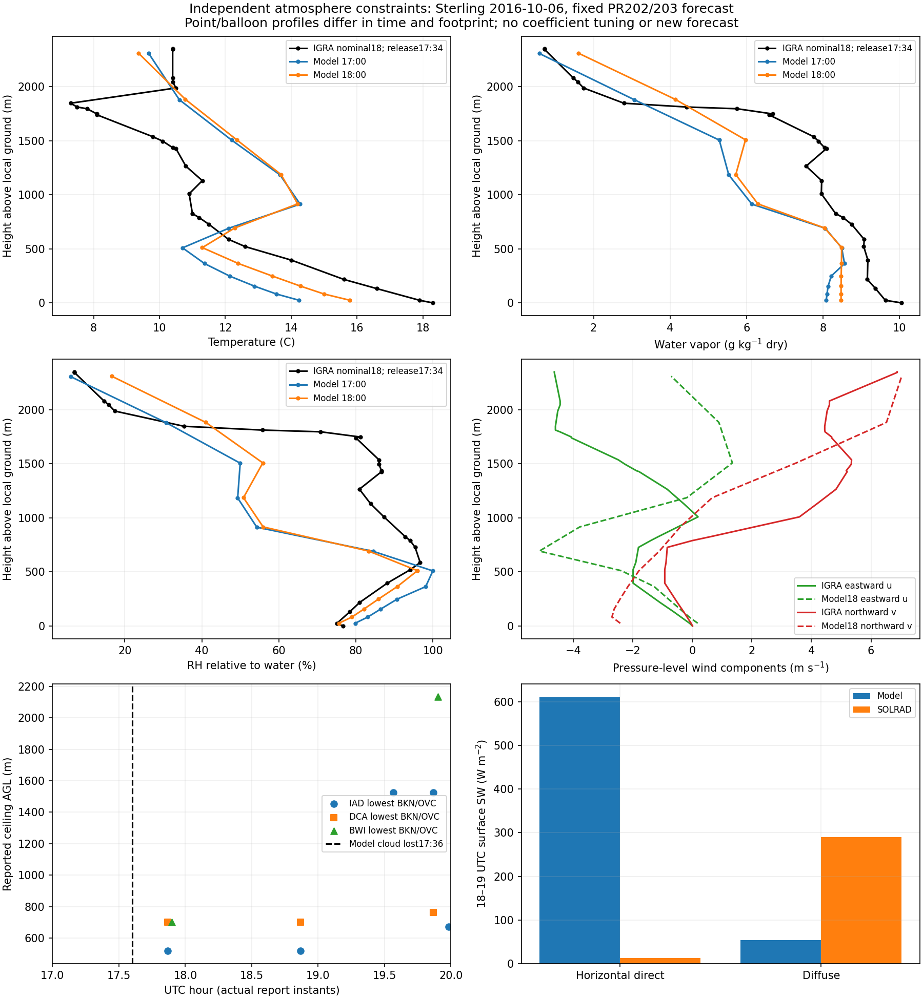

# Sterling 독립 대기관측 대조와 현재 연구 범위

검증 기준선은 PR203이 병합된 `d2223f13c28f06d9886f5d5febaeb2ad18b3a5a0`이다. 준비된 입력·실행파일·광학계수와 기존 PR202 cold 산출물은 유지하고, **독립 METAR와 NOAA IGRA 실제 관측을 확보해 대조**했다. 이 관측 분석에는 새 Sterling WRF/WPS/REAL/RTE/Mie 과학 실행과 계수·물리정책 변경이 없다. 문서 수정으로 발동하는 저장소의 일반 engineering build/SCM/host CI는 별도이며 새 Sterling 예보로 집계하지 않는다. 같은 날의 원인 진단이며 새로운 독립 예보 사례를 추가한 것은 아니다.

**판정:** 인근 낮은 구름 보고는 모델 소실 뒤에도 남고, 가까운 실제 시각의 관측과 모델은 6–7층 압력 구간의 온도 기울기 부호가 다르다. 현재 연구 기준선을 유지하되 오후 구름 지속성과 전천 SW 정량 예보 승인은 보류한다. 다음 단일 대조 경계는 **기존 입력·경계와 상태 발달의 저층 온도·수증기·역전 구조**다. 광학 배율이나 PBL 혼합계수 조정의 고유 근거는 아직 없다.

## 실제 구름 보고와 시간 지원

IEM의 운영 METAR/SPECI archive에서 원문을 받았다. 주 관측소는 사전에 고정한 IAD이며, DCA/BWI는 공간 문맥만 제공한다. 원 Sterling SOLRAD 지점·격자·UTC·QC·전체시간/주간 일사 점수는 유지한다.

| UTC 보고시각 | IAD 원문 구름 | 가장 낮은 BKN/OVC 운저, AGL |
|---|---|---:|
| 17:52 | BKN017 OVC027 | **518.16 m** |
| 18:52 | BKN017 OVC025 | **518.16 m** |
| 19:34 | SCT022 BKN050 | 1,524.00 m |
| 19:52 | SCT022 BKN050 | 1,524.00 m |
| 19:59 | BKN022 OVC055 | 670.56 m |

모델의 해당 기주 마지막 구름물은17:35–17:36에 사라졌지만, IAD의 낮은 BKN/OVC 보고는17:52·18:52에도 존재한다. 같은 구간 DCA는 OVC, BWI는17:54 BKN에서18:14 SCT로 바뀐다. 이는 공간적 차이가 실제 있음을 보여 주며, 모든 인근 지점을 동일한 구름장으로 간주할 수 없다. 5개 IAD·3개 DCA·4개 BWI의 실제 보고를 모두 남긴다. 보고 사이를 carry-forward해 연속 구름 지속시간이나 hourly cloud fraction으로 만들지 않는다.

Archive metadata상 IAD–SOLRAD 거리는 약5.37 km, IAD–원 모델 격자 중심은 약6.26 km다. 모델 격자는27 km이며 SOLRAD–격자 거리는 기존 약9.006 km다. IAD 관측에 더 잘 맞는 모델 셀을 새로 고르지 않았다. ASOS 운저는 점 센서·시간 표본의 결과이며 WRF의 격자 평균 CF나 층 중심과 같은 물리량이 아니다. 자동 ceilometer는 보고 높이·얇은 구름 감지에 제한이 있다. [IEM archive와 API](https://mesonet.agron.iastate.edu/cgi-bin/request/asos.py?help=) · [NWS ceilometer 정의](https://www.weather.gov/asos/Ceilometer.html)

## 명목18시 sounding은 실제17:34 발사다

NOAA IGRA `USM00072403`의 전체 원 ZIP을 실제 다운로드한 뒤, 명목00·12·18시와 다음날00시의 네 sounding block을 원문 바이트 그대로 추출했다. **주 sounding의 RELTIME은1734**이며 ETIME은 초 정수가 아니라 **MMMSS**다. 예를 들어121은81초다. 명목18시를 모든 층의 실제 관측시각으로 사용하지 않았다. [공식 IGRA 자료 형식](https://www.ncei.noaa.gov/data/integrated-global-radiosonde-archive/doc/igra2-data-format.txt)

PR203에서 실제 관측한 source17:35 microphysics 직전 상태와 같은 압력으로 보간한 관측은 다음과 같다. 물리시간은17:35–17:36 step이다.

| native 층 | 압력, hPa | HHMM 초00 가정·압력 보간 시각 | 모델 기온, °C | 관측 기온, °C | 모델−관측 qv, g/kg dry |
|---|---:|---|---:|---:|---:|
| 5 | 970.2083 | 17:34:58.9 | 11.8032 | 14.0632 | −0.7325 |
| **6** | **953.5025** | **17:35:23.8** | **10.6661** | **12.4926** | **−0.6065** |
| **7** | **933.0809** | **17:35:58.1** | **12.1684** | **11.5432** | **−0.7348** |

같은6→7층 압력 구간에서 모델 기온 변화는 **+1.5023 K**, 관측은 **−0.9494 K**다. 모델은 그 구간에서 위로 따뜻해지지만 관측은 식는다. 발사시각은 HHMM까지만 제공하므로 표의 초 단위는 발사 초를00으로 둔 표시이며, 원 ETIME 사이에서 압력 보간한 값이다. 이 표시 기준에서6/7층은17:35–17:36 안에 있고5층은 step 시작보다 약1.1초 빠르다. 실제 발사 초와 층별 drift가 없어 substep과 정확히 동시라는 주장으로 사용하지 않는다. 이 대조는 PR203의 source를 다시 계측한 것이 아니라, 이미 보존된 실제 상태에 새 독립 관측을 연결한 것이다.

모델6층의 수면 RH는99.890%, 관측 dewpoint 기반 native 수면 RH는94.710%이며 IGRA 보고 RH는94.959%다. 7층은 모델83.909%, 관측95.492%다. 기온·수증기가 함께 다르므로 RH 하나의 유사성만으로 같은 물경로·구름 상태라고 판단할 수 없다. 보고 RH와 동일 native 포화함수로 유도한 RH를 별도로 보존하며, 관측이 포화됐다고 강제하거나 sensor 오차를0으로 가정하지 않는다.

### 더 넓은 저층 구조

18시 native profile과 주 sounding을 같은 고정 압력에 보간한 차이다. 이 표의 모델은18:00 snapshot이며, 관측 층 시각은17:35–17:41이므로 동시각 오차로 재명명하지 않는다.

| 압력 | 모델−관측 기온 | 모델−관측 qv | 관측/모델 수면 RH |
|---|---:|---:|---:|
| 950 hPa | −0.798 K | −0.659 g/kg | 95.90 / 93.92% |
| 925 hPa | +1.703 K | −1.046 g/kg | 94.11 / 74.44% |
| 900 hPa | +3.115 K | −1.832 g/kg | 87.02 / 54.42% |
| 850 hPa | +2.374 K | −1.932 g/kg | 86.02 / 55.36% |

관측에 보고된300–2500 m AGL의 가장 큰 인접 온도 상승은 **1847–1988 m AGL에서+3.2 K**다. 모델18시의 가장 큰 native 인접 상승은 **693–916 m AGL에서+1.914 K**다. 해상도와 시간 지원이 다른 구간 비교이며, 이 두 높이의 차이를 정확한 PBLH 오차로 간주하지 않는다. 모델 PBLH는17시375 m,18시540 m지만 여기서 직접 관측한 PBLH는 없다.

관측 바람과 모델의 지구 좌표 성분도 같은 압력 표에 남겼다. 모델 U/V는 staggered 격자를 평균하고 COSALPHA/SINALPHA로 회전했다. METAR VRB는 풍향 결측/가변으로 유지하며0도 바람이나 무풍으로 바꾸지 않는다. profile의 습윤층·온도 상승과 바람 차이는 상태 불일치를 좁히는 근거이며, 관측 turbulent cloud-water flux가 없어 YSU 혼합강도만을 원인으로 확정하지 않는다.



## 계산·자료 계보와 남은 한계

- 기존 PR202 native history를 다시 실제 판독했다. 전체 파일 SHA256은 기존 저장 근거와 같고, 같은 `(37,119)`·143×90 격자를 유지한다. 00·12·17·18·19·20·다음00시 profile을 사용한다.
- `T`는 기온이 아니다. 기존 dry perturbation theta에300을 더하고 native pressure·Rd/cp로 진단 기온을 계산한다. qv와 cloud의 기존 끝상태를 source라고 부르지 않는다. PH+PHB의 native 합으로 높이를 계산하고, 관측 GPH도 지표 기준과 MSL을 구분한다.
- UDM의 변경하지 않은 포화 table/functions만 추출한 scalar helper를 compile1/run1했다. 실제 관측 T/Td·압력으로 qv·수면RH를 유도하고 모델에도 같은 함수를 적용했다. 이는 새 UDM·WRF·RTE 실행이 아니다.
- 모든 관측의 원래 missing/QC marker와 P/Z/T flag를 남긴다. −8888·−9999를0으로 바꾸지 않는다. 유효한 점 사이 log-pressure 보간만 하고 외삽이나 시간 보간은 하지 않는다. 원 관측 TEMP/DPDP 표시는0.1 K 단위지만 이것은 전체 기기 불확실도의 상계가 아니다.
- IGRA 고정 station header의 위경도는 sounding별 과거 위치를 복원한 값이 아니다. station history의 다른 좌표도 보존했지만2016년 실제 발사 위치나 층별 balloon drift를 확인했다고 주장하지 않는다. 명목 거리는 참고값이다. [공식 station history 설명](https://www.ncei.noaa.gov/pub/data/igra/history/igra2-metadata-readme.txt)
- IEM 운영 archive는 NOAA 연구용 QC 완료 원자료로 재명명하지 않는다. 원 METAR 본문·T group·구름 보고·원 export를 함께 보존한다. 표면 T와 바람의 가까운 hourly 대응은 시간 차이를 명시한 문맥이며 새 예보 점수로 합산하지 않는다.
- 원 SOLRAD 점수와18–19시 직달/산란610.17/53.67 대12.17/290.47 W/m²는 PR202/203의 그대로인 결과다. 대기 관측이 추가됐다고 이 큰 오차를 PASS로 승격하지 않는다.
- 관측 선택은 이미 오차를 본 같은 날·시간의 진단이다. 목적별 허용량, 관측 전체 불확실도·대표성은 아직 정하지 않았다. 관측은 WRF 출력에서 만든 값이 아니며, 외부 구동 분석에서 해당 관측을 자료동화에 사용했는지는 확인하지 않았다. 따라서 자료동화로부터 독립인 withheld 검증이라고 부르지 않는다. 새로운 독립 날짜·지점의 예보 검증이나 RRTMG/37 결합 비교를 수행한 것은 아니다.

원 CSV·네 sounding·형식 문서는 [raw](raw)에, 압력 대조와 판정은 [pressure-comparison.csv](pressure-comparison.csv)·[result.json](result.json)에 있다. HTTP URL·상태·시각·SHA, 원 ZIP의 해시·원문 추출 byte offset, 새 native 판독과 scalar helper 명령은 [saved/evidence.tar.gz](saved/evidence.tar.gz)에 보존한다. 전체 IGRA 원 ZIP(약102 MB)과 대형 NetCDF는 로컬에 유지하며 저장 재생은 정확히 보존한 raw subset을 읽는다. 입력값을 채우기 위해 모델 출력을 관측으로 사용하지 않는다. 처음 사용한 구식 format URL의404와 올바른 공식 URL의 성공도 따로 남긴다. 초기 verifier의 NumPy/stdlib REAL64 power 비트동일성 가정은 실제 native interface를 표현하지 못했다. 저장 값은 유지하고 Fortran이 소비한 REAL32에서 정확히 같은지 검사하도록 수정했으며 물리 허용량을 추가하지 않았다. 이 검사 실패의 원 코드·로그도 보존한다.

현재 안내 문서도 함께 고쳤다. 지정 number 문서는675/675 및450/450의 성공 범위와 역사적 실패를 구분한다. frozen1 문서는 radiation `rho_d*(1+qv)`와 현재 UDM dry-density 입력의 차이를 명시한다. density나 λ 계산을 변경하지 않았고, 같은 상태의 진단 PSD 참조 수치 검증은 유지한다. root README는 현재 구성·완료 근거·남은 과학적 판단을 연결하며 PR166의15/22 장부를 현재 완료율로 사용하지 않는다. 기존 두 historical full-WRF corpus 재생은 이전 frozen 문서의 정확한 바이트를 필요로 했다. 현재 설명을 되돌리거나 옛 해시를 바꾸지 않고 base commit의 원 문서를 별도 historical snapshot으로 보존해 같은 digest를 검증한다. 최초 full acceptance의 이 두 문서 identity 실패 로그도 보존했다.

저장 재생은 표준 라이브러리만 사용하고 모델·네트워크·compiler를 실행하지 않는다.

```sh
python -I -S validation/rrtmgp37/sterling-independent-atmosphere/verify_saved.py
python -I -S validation/rrtmgp37/sterling-independent-atmosphere/test_saved.py
```

현재 공학적 1차 완료는 유지한다. 기존 일곱 과학적 종료 조건, RFMIP/LBLRTM FAIL, frozen1의 실제 입자 적용성, 전체 물·에너지와 일반 예보 정확도의 미승인도 유지한다. 다음 조치는 새 limiter나 구름/광학 배율이 아니라, 확인된 저층 상태 경계를 대상으로 기존 입력·경계의 자료 계보와 온습도 발달을 이 관측에 대조하는 것이다.
