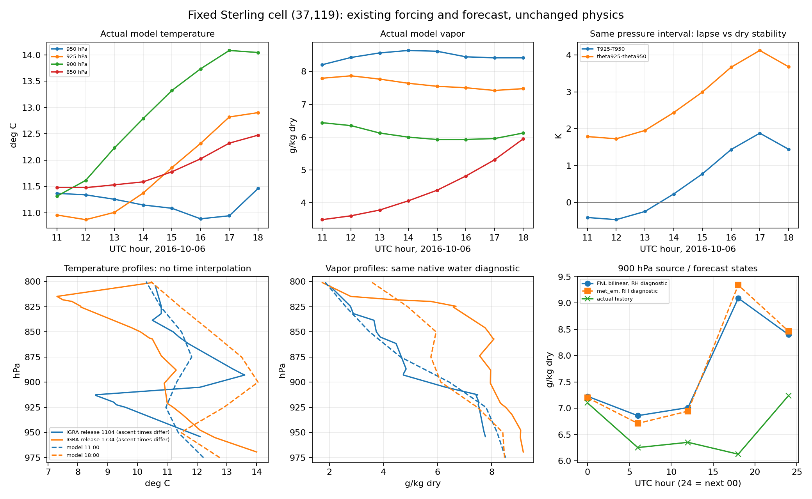

# Sterling 저층 온습도 구조의 발달과 기존 입력 계보 대조

기준은 PR204 병합 main `f51ad812ed51544e7a246dfc2677d8a17fa29e11`이다. 기존 PR202 cold history와 실제 사용한 FNL GRIB·WPS intermediate·새 영역의 `met_em`·REAL 초기장·지정경계를 **실제로 다시 읽어**, 같은 관측소 대응 격자 `(37,119)`의 저층 구조가 달라지는 구간을 좁혔다. 생산 계산·광학계수·물리정책·관측·전체시간 일사 점수는 변경하지 않았다. 새 WRF/WPS/REAL/RTE/Mie 실행도 없다.

**결정:** 900 hPa의 오후 온난 오차 일부는 구동 분석에도 있지만, 구동자료의 강한 습윤 발달을 내부 예보가 따라가지 못한다. 현재 자료가 전처리 변환 오류나 특정 PBL 계수 결함을 입증하지는 않는다. 다음 한정 대조는 **12–17 UTC, native 5–12층과 필요한 stencil의 기온·수증기 이류 대 물리 경향**이다. 이미 존재하는 12시 상태 오차를 보존하고, 그 뒤 역전층이 강화되는 과정을 분리한다. 17:35의 마지막 증발을 다시 추적하거나 계수를 조정하지 않는다.

## 기존 출력의 시간 지원을 보완했다

기존 고정 결과는 [PR204 관측 대조](../sterling-independent-atmosphere/README.md)에 그대로 있다. 후속 판독은 00·06·11·12·13·14·15·16·17·18·19·20·23·다음00시, 총14개 profile이다. 11–18시를 매시간 제시하고, 실제 11:04 및23:07 발사에 가까운 모델11·23시도 기존 명목12·24시와 **함께** 보존한다. 더 잘 맞는 시각이나 이웃 격자로 기존 점수를 교체하지 않았다.

예를 들어900 hPa에서 오전 sounding의 표시 시각은11:07:45.1이다. 모델11시의 차이는−465.1초로, 기존12시의+3134.9초보다 짧다. 다음날 명목00시 sounding의900 hPa는23:10:33.7이고 모델23시는−633.7초,24시는+2966.3초다. 발사 초는 미제공이므로 이 초 단위 표시는 HHMM의 초를00으로 놓고 ETIME을 압력 방향으로 보간한 값이다. 실제 풍선 위치·drift는 없으며 정확한 동시·동소 substep 관측으로 부르지 않는다. sounding 사이를 시간 보간하지 않았다.

모델900 hPa의 실제 hourly 상태와 고정950→925 hPa 구간의 기울기다.

| UTC | 900 hPa 기온, °C | 수증기, g/kg dry | T925−T950, K | θ925−θ950, K |
|---|---:|---:|---:|---:|
| 11 | 11.315 | 6.440 | −0.413 | +1.786 |
| 12 | 11.615 | 6.352 | −0.471 | +1.726 |
| 13 | 12.233 | 6.126 | −0.249 | +1.953 |
| **14** | **12.789** | **6.000** | **+0.226** | **+2.438** |
| 15 | 13.324 | 5.929 | +0.772 | +2.996 |
| 16 | 13.736 | 5.930 | +1.434 | +3.671 |
| 17 | 14.085 | 5.957 | +1.879 | +4.126 |
| 18 | 14.046 | 6.126 | +1.443 | +3.684 |

**13시에는 음수였던 고정 압력 구간의 온도 차이가14시에는 양수**다. 이는 해당 hourly 표본에서 온도역전이 나타나는 구간이지, 모든 저층 역전이나 전체 예보 오차의 최초 발생시각이 아니다. 건조 잠재온도 차이는11–18시 모두 양수다. 관측의 음의 기온 기울기를 건조 불안정으로 해석하지 않는다. θ는 같은 `Rd/cp=287/1004.5=2/7`로 계산했다. native 인접층의 최대 온도 상승·높이·PBLH도 따로 남겨 압력 구간과 혼동하지 않는다.

## 구동자료에는 습윤 발달이 실제로 있다

원래 보존된 FNL GRIB를 ecCodes로 직접 디코딩하고, 고정 격자 위경도를 둘러싼1도 격자 네 점과 bilinear 진단을 보존했다. 같은 위치의 WPS intermediate도 원 big-endian record·field·level·slab offset/hash와 함께 읽었다. 5개 source 시각마다 T/RH/U/V/HGT의 **160개 corner 값**을 대조했다. GRIB decode를REAL32로 바꾼 값과 intermediate 사이 최대 절대차는 T `3.0518e−5 K`, RH `7.6294e−6 percentage point`, HGT `2.4414e−4 m`이며 바람도 `9.54e−7 m/s` 이하다. 전체 ungrib 파일이 바이트 동일하다고 주장하거나 이 값을 물리 허용량으로 쓰지 않는다.

파일명뿐 아니라 GRIB의 실제 analysis/valid time·step0, intermediate HDATE·forecast hour0, `met_em`의 실제 Times도 원 파일에서 읽어 같은 시각인지 확인했다. 실제 `met_em`의 습도 변수 roster와 초기장·경계의 Times도 보존했다.

`met_em`은 같은 fixed WRF 격자에서 읽었다. 실제 METGRID.TBL의 T/RH는 `sixteen_pt+four_pt+average_4pt`이므로, 새 four-corner bilinear 진단과 동일 알고리즘이 아니다. 예를 들어18시900 hPa에서 FNL bilinear는285.3218 K·91.4881%, `met_em`은285.2687 K·94.3004%다. 이 차이를 보간 코드 결함으로 판정하지 않는다. 원 FNL과 intermediate는 과거 별도 배포 묶음에서 확보됐으며, 이번에 대조한 실제 값의 근접성을 넘어 전체 자료 계보의 동일성을 가정하지 않는다.

### 900 hPa의 오전→오후 상태 변화

| 자료 | 기온 변화, K | 수증기 변화, g/kg dry | 시간 지원 |
|---|---:|---:|---|
| IGRA 실제 관측 | **−1.788** | **+2.301** | 표시11:07:45→17:37:02, HHMM 초00 가정 |
| 실제 `met_em` | **+1.628** | **+2.400** | 12→18 UTC |
| 실제 내부 예보 | **+2.432** | **−0.226** | 12→18 UTC |

이 세 행은 같은 적분기간의 과정별 경향이 아니다. 다만 **구동 분석이 건조해서 습윤 입력이 전혀 없었다는 설명은 자료와 맞지 않는다.** 온도는 구동 분석부터 관측과 반대 방향으로 변화하며, 예보의 온난화가 더 크다.18시900 hPa의 `met_em`도 관측보다+1.187 K·+1.387 g/kg이므로 참값으로 취급하지 않는다. 예보는 같은18시 `met_em`보다+1.928 K·−3.218 g/kg이다. 나중 시각의 내부 `met_em`은 모델 내부에 매 step 직접 강제되는 값이 아니므로, 이 차이가 그대로 누락된 source나 수치 손실량인 것은 아니다.

### 초기화와 적분 중 차이를 구분했다

같은 지점·고정 압력에서 history00과 `met_em`00의 차이다. 실제 `wrfinput`00도 별도로 읽어 함께 보존했다.

| 압력, hPa | history00−met_em00 기온, K | 수증기, g/kg dry |
|---|---:|---:|
| 950 | +0.008 | −0.011 |
| 925 | −0.011 | +0.018 |
| 900 | +0.306 | −0.099 |
| 850 | −0.094 | +0.016 |

900 hPa의 같은 차이는06시+0.834 K·−0.460 g/kg,12시+1.124 K·−0.593 g/kg,18시+1.928 K·−3.218 g/kg이다. 초기화·진단 재보간 차이만으로 오후의 차이를 전부 설명할 수 없다. 그렇다고 이 표만으로 REAL 수직보간이나 내부 물리가 잘못됐다고 결론 내리지 않는다.12시에 이미 오차가 있으므로 다음12–17시 과정 비교의 시작 상태로 그대로 남긴다.

## 습도와 온도 정의

원 source RH percent를 보존했다. `met_em`에는 QV/SH가 없고 실제 REAL namelist는 `rh2qv_method=1`, `rh2qv_wrt_liquid=.true.`다. source의 qv 열은 이 **실제 REAL 방법1 수면식의 REAL64 진단**이다.

\[
e=\frac{RH}{100}\,611.2\exp\left[17.67\frac{T-273.15}{T-29.65}\right],\qquad
r=0.622\frac{e}{p-e}.
\]

`RH×포화 혼합비`로 대체하지 않는다. 원 코드의 RH 범위와 최소 qv 처리를 명시적으로 적용하지만, 이번 입력에서 이를 조정해 점수를 맞추지 않았다. 이 계산은 REAL 실행이나 그 전체 수직보간의 bitwise 재생이 아니다. 실제 `wrfinput`·`wrfbdy`·history의 qv는 파일에서 읽은 값이다.

관측 qv/RH는 PR204의 unchanged native 수면 포화함수 결과를 그대로 재사용했다. 새 모델·met profile의 비교 RH도 같은 scalar helper로 평가했다. REAL 식과 UDM 포화함수의 작은 정의 차이는 숨기지 않으며, source RH·diagnostic qv·native-derived water RH를 별도 열로 둔다. history `T`는 섭동 건조온위이므로300을 더하고 native REAL32 `P+PB`로 실제 기온을 진단했다. 수평 바람은 destagger 후 Earth 성분으로 회전했고, grid U/V와 native W도 별도 보존했다. `CLDFRA`는 held history 진단이며 실제 복사 호출의 fresh mask/CF를 새로 관측했다고 하지 않는다.

## 지정경계는 다른 위치·다른 결합 표현이다

서·동·남·북 경계에서 고정 관측소 행/열의 투영 위치를 선택했다. north는 `(37,143)`, 약44°N이며 관측소 내부 기주와 다르다. 실제 `QVAPOR_B*`, `T_B*`, `MU_B*`와 시간 경향을 읽고,

\[
a_k=C_{1H,k}MU+(C_{1H,k}MUB+C_{2H,k}),\quad
r_v=S_{qv}/a_k,\quad
\theta_d=\frac{S_T/a_k+300}{1+(R_v/R_d)r_v}
\]

로 복원했다. REAL의 `use_theta_m=1`이므로 `T_B*`는 **결합된 moist 섭동온위**다. 파일 설명의 K·kg/kg 표시만 보고 압력 결합을 무시하지 않는다.00시 초기장의 qv와THM을 native REAL32 순서로 재결합하면 네 경계 투영점 **각44층에서 두 변수 모두 바이트 동일**하다. 역변환 자체는REAL64 진단이며 원 native 상태의 모든 비트를 복원한다고 주장하지 않는다.

11·15·17시는 실제6시간 기록의 값과 경향에 해당 `dtbc`를 적용한 결합 target으로 보존했다.12·18시 값은 기록 시각 자체다. native eta 층으로 보고하고, **내부 기주의 압력을 빌려 경계 기온이나 관측 오차를 만들지 않았다.**

북쪽 native7층 target qv는12시7.048→18시8.545 g/kg이며,6→7층 dryθ 차이는+2.289→+1.270 K다. 같은 두 시각의 실제 history 북쪽 face에서6·7층 normal wind는 모두 유출 부호지만,9·10층에는 유입도 있다. 이는 수송 문맥일 뿐 back-trajectory나 경계 기여 수지가 아니다. **유출 부호가 완화 함수를 끄는 것은 아니며**, 이전 시간·간접 경계 영향을 배제하지 않는다.

고정 북쪽 단면도 남겼다.17시900 hPa에서 원 기주 qv는5.957 g/kg이고 `(37,143)`는9.173 g/kg이다. 중간에는 더 건조한 기주도 있다. 이 공간 구조만으로 특정 경계의 직접 건조 유입을 인과적으로 확정하거나, 잘 맞는 이웃 격자로 기존 관측 점수를 바꾸지 않는다.



## 완료 판정과 다음 한 경계

이번에 완료한 것은 **기존 출력의 시간 보완, source→전처리→초기장·경계→예보의 실제 값 연결, 차이의 발달 구간 판정**이다. 원 자료를 보지 않은 채 다음 조사 목록만 추가한 작업이 아니다. 초기장부터 모든 저층이 과도하게 건조했다는 설명, 구동자료에 습윤 발달이 없었다는 설명, 새 광학 오류라는 설명은 현재 근거가 지지하지 않는다.

선택한 다음 대조는12–17 UTC native5–12층의 **온도·수증기 이류와 물리 경향의 분리**다.13–14시 사이 고정 압력 역전이 나타나고17시에 강해지는 구간을 포함한다. 상태차분을 실제 source로 재명명하지 않는다. 그때 필요한 자료가 현재 history에 없으므로 기존 checkpoint의 한정 계측이 필요할 수 있지만, 이 PR은 새 WRF 실행을 하지 않았다. PBL 계수·CF 하한·광학 배율·새 policy·입력 교체를 정당화할 결함은 아직 확정하지 않았다.

현재 직렬 연구 구성의 공학적 완료, 이전 재시작·비음수·강수율·SW 반환·조건부 frozen 수치 검증은 유지한다. 오후 구름 지속성·전천 SW 정확도는 미승인이며, 같은 하루의 사후 원인 진단을 새로운 독립 예보 사례나 자료동화에서 보류된 관측 검증으로 부르지 않는다. 기존 일곱 과학적 조건·RFMIP/LBLRTM 실패·전체 물/에너지·frozen 실제 입자 적용성은 변경하지 않았다. 양의 dryθ 차이를 습윤 안정도나 관측 PBLH의 직접 측정으로 확대하지 않는다.

원 산출물은 [result.json](result.json)·[hourly-pressure.csv](hourly-pressure.csv), 정확한 판독 subset·원 파일 해시·native helper 입출력·전처리 receipt는 [saved/evidence.tar.gz](saved/evidence.tar.gz)에 있다. 대형 native NetCDF·GRIB·intermediate는 로컬에 계속 보존한다. 저장 재생은 표준 라이브러리만 쓰며 대형 파일·네트워크·모델·compiler를 실행하지 않는다. 개발 중 첫 보고기의 모듈 import 충돌은 수정했고, intermediate 높이 field의 실제 이름 `HGT`를 추가해 최종 체인을 판독했다. 그 전 로그도 보존했다. 같은 unchanged saturation binary의 실제 scalar 실행은 개발·최종 각1회, 총2회이며 새 compile은0회다. 저장소 CI의 engineering build/SCM은 새 Sterling 예보와 별도로 집계한다.

```sh
python -I -S validation/rrtmgp37/sterling-low-level-evolution/verify_saved.py
python -I -S validation/rrtmgp37/sterling-low-level-evolution/test_saved.py
```
