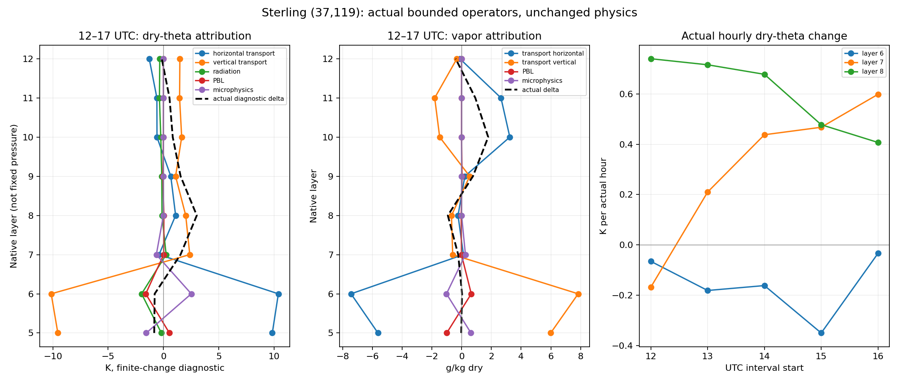

# Sterling 12–17 UTC의 실제 온도·수증기 경향 귀속

기준은 PR205 병합 main `4a5d5cfb391d2aa09cbab0c81bd815a33534f17b`다. 이전에 선택한 **2016-10-06 12–17 UTC, `(37,119)`의 native5–12층**을 실제 적용 연산으로 분리했다. PR202 cold의11:58 checkpoint에서 같은 forcing·물리·계수로17:00까지 한정 재개했다. 생산 WRF 소스와 기본값을 변경한 것이 아니라, 로컬 복사본에 입력 전용 관측 호출을 추가해 빌드했다. 새 cold24시간·WPS·REAL·독립 RTE/Mie 실행은 없다.

**결정:** 6층은 복사·PBL 냉각과 미세물리 가열이 크게 상쇄되고,7–8층은 수송으로 온난·건조해진다.9층은 수평·수직 수송이 모두 습윤화하고10–11층은 수평 습윤화가 수직 건조화를 상쇄한다. 새 생산 결함이나 계수 변경의 근거는 확정하지 않았다. **이번 층별 경향 분리는 완료**로 정리하고, 다음 단일 상태 경계는 **native7–8층의 수직수송, 인접 온위/수증기 기울기와 좌표에 맞는 수직운동의 물리적 적합성**으로 좁힌다. 이 귀속을 PBL·복사 정확도의 승인으로 바꾸지 않는다.

## 실제 실행과 원 궤적 연결

| 항목 | 실제 결과 |
|---|---:|
| 한정 WRF 재개 | **11:58–17:00,302 step** |
| 주 계측 구간 | **12:00–17:00,300개60초 구간** |
| 중앙 기주 | 고정 `(37,119)`, native5–12의8층 |
| 필요한 주변 상태 | i34–40,j116–122,k4–13, source-hour12·13·14·15·16시 |
| 기존 cold와 겹친 history | **12–17시6기록×225배열=1,350쌍, 모두 바이트 동일** |
| 공개 생산 계산·계수·정책 변경 | **없음** |

source61140초의 마지막 `end`가17:00 상태다. RK1/2의 predictor를 각각 별도60초로 합산하지 않았다.17시 이웃을 새 substep 관측으로 꾸미지 않았으며,17시 중앙 endpoint는 실제 history와 연산 종단이다. 같은 날·같은 궤적의 원인 진단이고 새로운 독립 예보 사례나 일반 재시작 캠페인이 아니다. 원 SOLRAD 전체24시간·주간 점수, 지점과 격자 선택,12시부터 존재한 상태 오차를 그대로 보존한다.

## 층별 결과: 하나의 ‘저층 건조화’가 아니다

아래는 각60초 실제 연산에서 선언한 moist/dry 온위 변환으로 나눈 뒤5시간 합산한 **건조 온위 기여, K**다. 순변화만 보고 상쇄를 지우지 않는다. 미세물리는 실제 호출 전후의 native dryθ 변화이며, moist 복원·반올림은 따로 남겼다.

| native층 | 실제 Δθd | 수평수송 | 수직수송 | 복사 | PBL | 미세물리 |
|---|---:|---:|---:|---:|---:|---:|
| 5 | −0.832951 | +9.846822 | −9.548673 | −0.186607 | +0.538607 | −1.552551 |
| **6** | **−0.791493** | **+10.393850** | **−10.149352** | **−1.973345** | **−1.600683** | **+2.520966** |
| **7** | **+1.545561** | **−0.396873** | **+2.382251** | **+0.244463** | **+0.021866** | **−0.641479** |
| **8** | **+3.017333** | **+1.102836** | **+2.017101** | **−0.128648** | **+0.043305** | **−0.000031** |
| 9 | +1.554304 | +0.666592 | +1.100768 | −0.150388 | −0.053528 | +0.000061 |
| **10** | **+0.842296** | **−0.582410** | **+1.651613** | **−0.238964** | **−0.000916** | **0** |
| 11 | +0.550064 | −0.590495 | +1.461637 | −0.360266 | +0.006348 | −0.000031 |
| 12 | −0.148190 | −1.284222 | +1.486988 | −0.331384 | −0.004517 | +0.000214 |

수평확산·질량결합의 정규화·실측 단계 bridge·native 산술 및 변환 차이도 [result.json](result.json)에 그대로 있으며 위 표의 생략 항을0으로 놓지 않는다. CU의 해당 기여는 실제 기록에서0이다.6층은 수평+수직 수송의 합이 약+0.2445 K인 반면, 복사·PBL 냉각이 합계 약−3.5740 K이고 미세물리가 약+2.5210 K 가열한다. 따라서6층 순냉각을 수직수송 하나나 PBL 하나의 오류량으로 부르면 안 된다.

7–8층의 **온난화에는 수송이 지배적**이다.8층의 직접 PBL 가열은 약+0.0433 K로 실제+3.0173 K와 구분된다. 그렇다고6층의 유의한 PBL 냉각까지 없었다고 주장하지 않는다.6→8층 건조 온위 대비의 증가에는 수송 차이·복사 차이·PBL 차이와 미세물리의 반대 기여가 함께 들어간다. 해당 대비의 항별 차이도 별도 보존했다. native 층은 시간에 따라 압력이 바뀌는 Eulerian η층이며, 고정950→925 hPa 기울기나 관측 PBLH와 같은 양이 아니다.

### 실제 수증기 변화, g/kg dry

| native층 | 실제 Δqv | 수평수송 | 수직수송 | PBL | 미세물리 |
|---|---:|---:|---:|---:|---:|
| **6** | **+0.031619** | **−7.431242** | **+7.834477** | **+0.649944** | **−1.016305** |
| **7** | **−0.228912** | **+0.122073** | **−0.599251** | **−0.010163** | **+0.256911** |
| **8** | **−0.924831** | **−0.238915** | **−0.679161** | **−0.026385** | **0** |
| **10** | **+1.787690** | **+3.240763** | **−1.473094** | **−0.001306** | **0** |

8층의 수직·수평 건조화와10층의 수평 습윤화가 구분된다.9층은 수평+0.216195, 수직+0.542210 g/kg으로 두 방향 모두 습윤화하며10–11층과 다르다.10층이 습해졌다고 수직수송도 습윤 source였던 것은 아니다.6층은 큰 수평·수직 교환, PBL 습윤화, 미세물리의 수증기 제거가 상쇄된다. 이 값은 혼합비의 실제 연산 귀속이며 독립적인 측면 face flux로 닫은 전 영역 물수지가 아니다.

### 같은5시간 안에서도 과정이 바뀐다

6층 PBL 기여는12–13시 약−0.0007 K,13–14시−0.0009 K,14–15시−0.0041 K지만15–16시에는−0.9116 K,16–17시에는−0.6834 K다. 후자의 두 구간에는 복사 냉각과 미세물리 가열도 함께 커진다. 반면8층은 각시간+0.7396,+0.7156,+0.6777,+0.4775,+0.4070 K씩 온난해진다. 이전의16시 구름 경로 증가와17시 감소를 단조로운 한 과정으로 바꾸지 않았다. 실제 시간별 항은 결과 파일과 [2,400행의 step-processes.csv](step-processes.csv)에 있다.



## 적분 변수와 기온을 구분한 계산

### 수증기

native source 사전갱신과 최종 RK 갱신의 실제 피연산자를 각각 기록했다.

\[
q^*=\frac{a_0q_0+\Delta tS_q}{a_0},\qquad
q_1=\frac{a_0q^*+\Delta t(m_yA_q+S_{\mathrm{RK}})}{a_1}.
\]

`a`는 Pa 단위 압력 결합계수이며 kg/m² 층질량이 아니다. PBL/CU와 scalar diffusion의 호출 전후 경향 차이를 기록하고, 실제 final-PD 발산의 수직·수평 적용 전후 배열을 읽었다. predictor의 값을 독립 물리기간으로 더하지 않았다. 분모 변경은 `q*×(a0−a1)/a1`, native 산술과 실제 stage bridge는 별도 항으로 둔다. 기록한 총경향에서 관측한 성분을 뺀 나머지는 이름 그대로 남기며 endpoint 잔차를 source로 맞추지 않는다.

### Moist 온위의 RHS와 음향 소단계

실제 physics dry 온위 경향이 moist 형태로 바뀌는 native 식을 사용했다.

\[
S_m=(1+r q_{old})S_d+r\frac{t_1+300}{1+r q_{old}}S_q,\qquad r=R_v/R_d.
\]

`phy_ra_ten/phy_bl_ten/phy_cu_ten` 전후의 dry 온위·수증기 경향, 변환 전후의 전체 경향을 연결했다. 이어서 실제 `rk_addtend_dry`와 final-RK 음향 적분을 기록했다. large-step 수평/수직 발산, acoustic 보정 flux, map factor, 실제 소시간간격·횟수, pressure coupling과 full-state 복원을 사용했다. 소단계의 `t_2`는 이 시점의 결합 섭동 변수이므로 무조건300을 더해 기온으로 읽지 않았다.

이전 미세물리의 held `h_diabatic`은 RHS에 들어간 뒤 final `small_step_finish`에서 빠지는 실제 순서를 재생했다. 그 가열을 다시 독립 source로 더하지 않았다. acoustic 각단계 전후를 기록해 실제 덧셈·flux 갱신의 산술 차이도 관측값으로 분리했다. native7–8층에 대해 ‘수직수송’이 양이라는 사실을 곧바로 관측된 하강류나 Lagrangian 공기덩이 가열로 해석하지 않는다. η좌표 수송과 기하학적 W의 의미는 다르다.

### 건조 온위 귀속의 명시적 정의

결합 섭동 moist 온위 `B=a t_m'`, `θm=t_m'+300`, `D=1+r q`라 두면 선언한 REAL64 진단에서

\[
\Delta\theta_m=\frac{\Delta B-t_{m,0}'\Delta a}{a_1},\qquad
\Delta\theta_d=\frac{\Delta\theta_m}{D_1}-\frac{r\theta_{d,0}}{D_1}\Delta q.
\]

따라서 같은 과정의 accepted moist 온위 항과 수증기 변환 항을 함께 표시한다. 모든 성분은 그 step의 같은 endpoint 분모를 사용한다. 이는 **선언한 유한변화 진단 배분**이며, 각 과정을 끄고 재적분한 고유 인과 효과가 아니다. dryθ를 잘 맞추려고 특정 성분에 잔차를 더하지 않았다. microphysics의 직접 native dryθ 변화와 moist-finish 변환·반올림도 분리했다.

기온은 다시 `T=θd Π`이므로

\[
\Delta T=\Pi_1\Delta\theta_d+\theta_{d,0}(\Pi_1-\Pi_0)
\]

로 온위 변화와 압력·Exner 변화를 따로 보고한다.8층의 기온 변화 진단+2.911835 K는 온위 변화 기여+2.936148 K와 압력 기여−0.024313 K의 합이다. 이것을 층열용량으로 환산한 독립 복사열원이나 전체 에너지 폐합이라고 부르지 않는다. native 식의 상수 `Rv/Rd`는 REAL32로 사용하고, dryθ 진단은 REAL64이므로 cold history가 저장한 별도 rounded dry T 표현과 마지막 비트가 다를 수 있다. 직접 cold 비교는 이런 진단 차이를 대신 쓰지 않고 원 배열 바이트로 수행했다.

## 실제 재생과 기록 범위

| native REAL32 재생 | 검사 수 |
|---|---:|
| PD 수증기 source 갱신 | **2,400** |
| 최종 RK 수증기 갱신 | **2,400** |
| moist 온위 경향 변환 | **2,400** |
| final-RK 온위 RHS 조립 | **2,400** |
| 음향 RHS 덧셈 / flux 갱신 | **9,600 / 9,600** |
| 음향 full-state 복원 | **2,400** |
| 연속 step의 실제 온위·수증기 연결 | **2,392** |

final RK에는 소단계15초×4회=60초가 실제로 연결된다. 큰 수증기 발산의 방향별 값과 slow 온위 H/V는 실제 native tendency 배열의 전후 차이이며, 각각의 모든 고차 interpolation face를 별도 native 커널로 재실행했다고 주장하지 않는다. acoustic flux와 RHS·갱신은 기록한 실제 피연산자로 비트까지 재생했다. 최종 scalar도 실제 결합계수·native 연산 순서로 재생했다.

REAL64 진단의 step별 재조합 잔차 최대는 dryθ 약`1.18e−13 K`, 수증기 약`6.35e−21 kg/kg`다. 원 값을 남기며0으로 반올림하거나 물리 허용량을 조정하지 않았다. 이 작은 재조합 잔차는 모델이 실제 대기의 혼합·수송을 맞췄다는 증거가 아니다. 기존 물·전체 에너지·frozen 물성·RFMIP/LBLRTM 및 일곱 과학적 종료 조건은 미승인 상태 그대로다.

## 완료·다음 조치·README 정리

이번 단계는 시간별 온습도 상태차분에서 더 나아가 **실제 적용 연산의 층별 귀속과 다음 경계 결정까지 완료**했다. 다음에는7–8층의 수직수송이 사용하는 인접 θ/qv 기울기와 좌표 정의에 맞는 수직운동 상태를 기존 구동·독립 대기 근거에 연결한다.6층의 복사·PBL·미세물리 상쇄는 함께 보존하며, 지금 PBL 계수나 광학량을 조정해 상쇄를 지울 근거는 없다. 동일한5시간 합산·17:35 소멸·무변경 하루를 다시 다음 주력으로 두지 않는다.

루트 README의 P3도 반영했다. [PR205의 완료 근거](../sterling-low-level-evolution/README.md)와 이번 결과를 첫 상태표에 연결하고 실제 다음 작업을 갱신했다. PR203의 고정 생산 기준선 표시는 유지한다. PR204 검증은 당시 루트 README의 정확한 바이트를 검사하고 있었으므로, 원문을 [historical snapshot](../historical-source/root-README-after-PR204.md)으로 보존해 같은 SHA256 검사를 유지했다. PR204 identity에서 그 문서 경로와 설명만 옮기고, PR205의 해당 identity 의존 pin만 갱신했다. **과거 과학 결과·raw archive·원 문서 SHA를 소급 수정하지 않았다.** 변경 전 두 identity와 README는 이번 archive에도 보존해 이 문서 의존 갱신만 있었는지 검사한다. 앞으로 루트 탐색 문구가 바뀔 수 있으므로 이번 검증은 루트의 발행 당시 snapshot을 검사하며 향후 탐색 문구를 과거 과학 근거로 강제 고정하지 않는다.

실제 신규 계산은 private 증분 빌드9개 process(7 compile+archive+link), 한정 WRF1회다. 새 cold24h·WPS·REAL·standalone RTE/Mie·포화함수 helper 실행은0회다. source와 공개 생산 라이브러리, actual executable·checkpoint·forcing·namelist·history·원 관측 로그를 [identity.json](identity.json)과 [saved/evidence.tar.gz](saved/evidence.tar.gz)에 연결한다. 개발 중 느린 acoustic roster 순회는 indexing으로 개선했으며 전체 결과가 동일함을 확인했다. 저장 재생은 표준 라이브러리만 사용하고 모델·compiler·network·대형 NetCDF를 실행/판독하지 않는다.

```sh
python -I -S validation/rrtmgp37/sterling-thermodynamic-tendencies/verify_saved.py
python -I -S validation/rrtmgp37/sterling-thermodynamic-tendencies/test_saved.py
```
